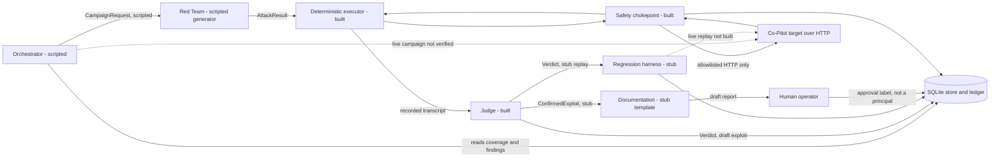
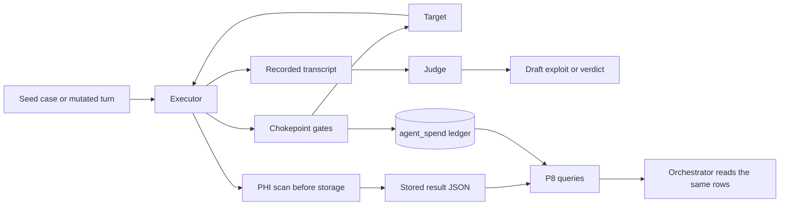

# AgentForge platform architecture

## Summary

**Status at commit 17827fb (P11 documentation pass).** Scripted and stub paths for all four agents are built. A live run of the four agents together is not. Every claim below is labeled **Built** (with a file path) or **Planned** (with the checkpoint that owns it). Nothing planned is described as working. Committed code keeps `LIVE_ENABLED` and `PROVIDER_ENABLED` false.

AgentForge is a multi-agent adversarial evaluation platform for the OpenEMR Clinical Co-Pilot. The Co-Pilot is an external HTTP target that the platform reaches only through one allowlisted chokepoint. Four agents hold distinct roles and trust levels, because the PRD says an agent that both generates and judges attacks is compromised by design.

The **Orchestrator** reads coverage gaps, open high-severity findings and recent regressions from the store, and chooses the next campaign. It sends a `CampaignRequest` to the Red Team. Ranking, the cost stop and the dispatch journal are built and proven on scripted evidence. A live campaign that uses them is not. The **Red Team** turns a campaign into an attack sequence. `SeedMutator` is deterministic and calls no model. `RedTeamGenerator` validates model output, novelty and multi-turn bounds on scripted evidence only. The **Judge** decides whether an attack succeeded. It is independent of the Red Team and reads only an executor-recorded transcript, never the attacker's claim of success. Deterministic graders run first. A language model is consulted only for an ambiguous transcript, and it comes from a different model family than the Red Team. The **Documentation** agent turns a confirmed exploit into a draft report after required-field and uniqueness checks. That path is a template on stub evidence. It never publishes. A human approves critical and high findings. The three reports in `reports/` are fixture drafts, not deployed-target findings.

Agents exchange versioned JSON messages defined in `contracts/v1/`, with typed error schemas for the PRD failure modes: target unreachable, budget exceeded, judge timeout, no findings in window and regression detected. Handoff is direct invocation of typed Python objects plus a SQLite store. There is no queue and no wire protocol between agents. ADR-003 rejected a queue.

Safety comes first. No request leaves the platform unless it passes the allowlist, a budget with a kill switch, a spend-approval gate and a request-rate cap. A persistent ledger holds one shared $5 ceiling across every billable call, including the target's own spend caused by the attacks. Transcripts are scanned for PHI-like patterns before storage, and all fixtures are synthetic.

Evidence is labeled by what it measured. Three graded cases, one each from prompt injection, data exfiltration and denial of service, passed against a local target at `127.0.0.1:8300`. One live Red Team call was stored and traced to a ledger row. These are defense-held results, not discovered exploits. The D-13 load test completed 100 of 100 chats on the Week 1 stub route (`evals/results/d13-load.json`). Orchestration took 90.13541795802303 seconds. Stub LLM latency was 0.0 seconds. Storage wrote 5991.5354876013225 rows per second. The bottleneck is the agent's 60-chat rolling minute. Measured stub spend is `$0`. That run is not a real-provider benchmark and does not close the public-URL gate. The Judge was measured on four labeled items and, with a provider model, on one ambiguous item, so no error rate is claimed. There is no public deployed URL. That is open gap H-1, owned by the operator. Total committed spend is $0.1522 of the $5.00 ceiling (three target reservations written as incurred plus provider calls). Peer integration was not done. No cohort peer was assigned.

## Agents

| Agent | Role | Inputs | Outputs | Trust level | Model | Status |
|---|---|---|---|---|---|---|
| Orchestrator | Choose the next campaign from coverage, findings and regressions | Store reads, budget state | `CampaignRequest` (`contracts/v1/campaign_request.schema.json`) | Trusted to schedule. Never judges or publishes | `TBD` in `config/models.yaml`, rules first | Built, scripted (`src/agentforge/orchestrator/`). Not met on a live run |
| Red Team | Propose attack sequences within a budget | `CampaignRequest`, seed cases in `evals/cases/` | `AttackResult` (`attack_result.schema.json`) | Untrusted by the Judge. Its claims are never evidence | `openai/gpt-4.1-mini` configured. `SeedMutator` is deterministic and calls no model | Built, partial (`src/agentforge/agents/red_team.py`) |
| Judge | Decide pass, fail or partial independently | Executor-recorded transcript (`recorded_transcript.schema.json`) | `Verdict` (`verdict.schema.json`) or a draft `ConfirmedExploit` (`confirmed_exploit.schema.json`) | Independent of the Red Team. Output is proposed evidence, not truth | `anthropic/claude-sonnet-4.5`, ambiguous cases only | Built (`src/agentforge/agents/judge.py`) |
| Documentation | Write a reproducible report from a confirmed exploit | `ConfirmedExploit` | A draft report. Publication is a human act | A draft until a human approves | `TBD` in `config/models.yaml`, template and validation first | Built, stub (`src/agentforge/agents/documentation.py`) |

Supporting components, which are not agents:
- **Built.** The deterministic executor and graders (`src/agentforge/evals/`), the safety chokepoint (`src/agentforge/safety/`), the cost ledger (`src/agentforge/safety/ledger.py`) and the SQLite store (`src/agentforge/store/`).
- **Built (R4, offline).** The seed suite has 26 cases that each pass the PRD p.11 validity gate on case metadata and synthetic bodies. `evals/owasp_coverage.json` records what the suite does and does not observe and closes no PRD requirement: A01, A04 and A09 cite stored results and are covered within the limits named in those rows, and neither is a closed row, LLM06 cites the stored four-pattern count and is not a closed row, LLM02 cites the deployed dock observation, and LLM08 cites the stored input-validator observation. `seed-tm-tm-1` remains a response-claim proxy, not tool-invocation proof. `evals/results/offline-latest.json` holds synthetic safe and weakened replays and is not target behavior. The unobserved halves are R10 for the public-target repeat, and the open gaps U1 to U5 in `Docs/PRD_TRACEABILITY.md`. None of those has run.
- **Built (P7, stub).** The regression harness (`src/agentforge/harness/`). Live replay is not built. R3 adds a replay seam (`ReplayTarget`) and a `ClientReplayTarget` over the chokepoint client. The client path is wired and tested only with a fake chokepoint target. It cannot run while `LIVE_ENABLED` is false. A fix-validation line states its replay basis (`stub`, `client_verified` or `unverified`). `client_verified` proves transport and sequence provenance only, not a validated fix, and no line carries it today.

## Interaction diagram

Solid edges are built on scripted or stub evidence. Dashed edges are not verified on a live multi-agent run. A solid edge is not a live campaign.

`scripts/orchestrate.py --dry-run` runs one scripted campaign. `scripts/regress.py` replays a pending handoff on an in-process stub and refuses `--live`. A report's source line follows verified send-time provenance (`fixture`, `unverified` or `recorded_verified`), never `fake_transport` alone, and `recorded_verified` has been proven only on constructed facts. The executor, not the Red Team, records the transcript the Judge reads. A live four-agent run against a public target is not built.

## Communication design

- **Built.** Four v1 messages and one transcript schema in `contracts/v1/`. Each carries `schema_version` `v1` and a `correlation_id`. Validation is in `src/agentforge/contracts/validate.py`.
- **Built.** Agents are invoked directly as typed Python objects. State is shared through the SQLite store. ADR-003 rejected a queue, a graph framework and conversation-style agent libraries.
- **Built (P6, scripted).** A persisted state machine carries one correlation id through scripted agents (`src/agentforge/orchestrator/`). A live run of that chain is not verified.

## Trust boundaries and human gates

- **Built.** The target is untrusted and its output is data, never instruction. Only the allowlist chokepoint reaches it (`src/agentforge/safety/chokepoint.py`). The Judge does not read the Red Team's claims. An exploit is created as `draft`, and the insert path refuses `published` (`src/agentforge/store/records.py`, `tests/test_store.py`).
- **Built (P7, stub; P9, in-process).** A human gate moves a draft to `pending_approval` and then to `published` or `rejected`. Publication and remediation authorization are different records. Agents may propose a patch and never apply one. `approved_by` is a stored label, not an authenticated principal (`Docs/ACCESS_CONTROL.md`, `src/agentforge/store/access.py`). Direct SQL by the process owner remains possible (ADR-005).

## A. Agent failure and recovery

PRD basis: "how they recover from failure", the typed error list, and the Appendix cascading-failure questions.

- **Built.** A refused chokepoint gate raises and is logged (`src/agentforge/safety/refusal_log.py`). A budget refusal returns a typed `budget_exceeded` (`src/agentforge/agents/red_team.py`). A Judge timeout returns `judge_timeout` with `retryable: true` and detail `needs_human_review`, and the reservation is released (`src/agentforge/agents/judge.py`). A crash cannot leave a reservation open: the `_Reservation` guard in `src/agentforge/agents/probe.py` and `Ledger.settle_orphan` in `src/agentforge/safety/ledger.py`. The kill switch halts before the next call (`src/agentforge/safety/budget.py`).
- **Built (P6, scripted).** A persisted dispatch journal resumes a scripted run after a crash (`src/agentforge/orchestrator/journal.py`, ADR-008). A live kill of an agent mid-campaign is not verified. Populated `run_logs` states are written by the scripted loop, not only named in the schema.
- No agent is retried automatically today. A caller sees the typed error and decides.

## B. Versioned handoff and error schemas

PRD basis: versioned schemas, typed errors, contract tests, and a migration note for each interface change.

- **Built.** Four v1 messages, `recorded_transcript`, five error schemas and a shared `error_envelope` with a `retryable` flag, all in `contracts/v1/`. Producer and consumer tests (`tests/test_contracts.py`, `tests/test_contracts_nested.py`) and a schema-diff CI check (`scripts/check_schema_diff.py`) reject a breaking change that has no version bump. Optional-field additions made without a bump are logged in `Docs/DECISIONS.md` section 5, and store changes have notes in `Docs/migrations/`.
- **Built (P7).** `RegressionTrigger` and `RegressionResult` stay names in `Docs/DEFENSE_PACKET.md`. They are not in the PRD typed-message list, so they are not new v1 schemas. The version handoff row is the trigger. `regression_detected` is the result.
- Handoff today is direct invocation plus the store. There is no wire protocol.

## C. Orchestrator prioritization and stopping policy

PRD basis: reads coverage gaps, open findings and regressions; halts when spend produces no signal; has a no-priority fallback; triggers regression when the target changes.

- **Built (P6).** `src/agentforge/orchestrator/` ranks from persisted evidence only (`priority.py`), stops or redirects once when spend yields no validated signal (`stop.py`), and journals every external effect write-ahead (`journal.py`, [ADR-008](Docs/adr/008-dispatch-journal.md)). A version change writes a handoff and does not replay it (`versions.py`). Weights and bounds are in `config/orchestrator.yaml`.
- **Built (P7).** `trace_agents` lists Orchestrator, Red Team, Judge and Documentation under the campaign correlation ID when each has a `run_logs` row (`trace.py`). The P6 trace still omits Documentation on a P6-only run. Live replay of that chain is not built.

## D. Exploit-to-regression lifecycle

PRD basis: a confirmed exploit becomes a deterministic case; detect reappearance and cross-category regression; a passing regression must mean fixed, not drifted.

- **Built.** The Judge turns a canary-graded `fail` into a draft `ConfirmedExploit` and never publishes. The store has `exploits` (`draft`, `pending_approval`, `published`, `rejected`), `regression_cases` with a foreign key to an exploit, a unique `sequence_hash`, and required-field checks (`src/agentforge/store/schema.sql`, `records.py`). Duplicate and incomplete inserts are rejected (`tests/test_store.py`).
- **Built (P7, stub only).** A confirmed fail becomes a regression case. The suite claims a version handoff and appends `regression_runs` per case, target pin and repeat. `lifecycle` is a cache of the latest pin, not history. A pass is the category invariant: a canary case can pass on HTTP 200, and 401/403 is a pass only for missing authority. Wording-only agreement is not `fixed`. Reappearance and a cross-category fail of a previously fixed case emit `regression_detected`. The Documentation agent writes a draft from a template and updates fix-validation from those runs. Publication and remediation authorization are separate human gates. Agents propose a patch and never apply one. Reports are platform drafts, not live target findings.
- **Planned.** Live replay against the deployed target. That path stays blocked: no public URL, empty allowlist, no provider attestation, and `LIVE_ENABLED` is false. An interrupted stub claim may re-execute an uncommitted repeat. A live replay must not copy that rule.
- The live results so far are defense-held passes. No exploit has been confirmed against the target.

## E. Observability and data flow

PRD basis: the six observability questions, which must also be readable by the Orchestrator.

- **Built.** `agent_spend` holds per-role reserved and incurred spend as separate columns (`src/agentforge/store/migrations/0002.sql`, `src/agentforge/safety/ledger.py`). The refusal log is `evals/results/refusals.log`. It is created at runtime by the live scripts (`scripts/live_campaign.py`, `scripts/live_agent.py`) on the first refused call, so it does not exist in a fresh clone. Stored results carry correlation ids (`evals/results/campaign-latest.json`, `evals/results/agent-live.json`), and `ledger_call_id` ties a live result to its ledger row. The four P2 tables exist: `exploits`, `regression_cases`, `run_logs`, `coverage_metrics`. ADR-006 chose our own SQLite traces over a hosted tool, so no third party receives transcripts. `run_logs` is written by `log_run` in `src/agentforge/orchestrator/state.py`. `coverage_metrics` has a writer, `coverage_from` in `src/agentforge/orchestrator/loop.py`, and that writer has no caller, so the table stays empty unless a test inserts a row.
- **Built (P8, read only).** `src/agentforge/observe/queries.py` answers the six PRD questions from existing rows. Authored cases, exploit rows and regression cases stay separate counts. Pass and fail use every `regression_runs` row as the denominator. Resilience compares shared case ids on adjacent recorded pins and returns `inconclusive` when that comparison is insufficient. Cost is incurred USD by role; reserved is not added. `python scripts/observe.py` prints the six answers and has no live path.

Data flow, Built unless marked:

## F. Model selection rationale

PRD basis: models chosen with refusal and cost in mind, and an independent Judge.

- **Built.** `config/models.yaml` sets `red_team` to `openai/gpt-4.1-mini` and `judge` to `anthropic/claude-sonnet-4.5`. A config where the two share a family is refused (`src/agentforge/models_config.py`, `tests/test_models_config.py`). The measured probe is in `Docs/MODEL_PROBE.md`:
  - The red_team probe call was refused, at $0.0000228.
  - The judge probe call completed, at $0.000291.
  - Each is one sample per family, not a refusal rate.
- **Planned.** `orchestrator` and `documentation` stay `TBD`. The intent is rules first, with a model only where a rule cannot decide. No model has been chosen and none is recommended here.
- **Consequence.** `SeedMutator` is deterministic and calls no model. `RedTeamGenerator` accepts scripted model output and has not been run against a provider in a campaign. The recorded red_team refusal remains one sample, not a refusal rate.

## G. Build-versus-configure justification

PRD basis: a build-versus-configure record for each agent role is required before it is implemented.

- **Built (as a document).** `Docs/BUILD_VS_CONFIGURE.md` evaluates Burp Suite, OWASP ZAP, Semgrep, Garak, promptfoo, PyRIT, commercial red-team platforms and plain deterministic tooling.
- **Decisions.** Red Team, Judge, Orchestrator and Documentation are custom, because the target is a stateful, session-authenticated, patient-scoped LLM application and the verdicts depend on our own invariants. The deterministic layer is small custom code. Web Top 10 scanning is configured with ZAP, not built. Semgrep is for the platform's own code.
- **Open.** ZAP has not been run. The P9 self-scan is pytest, mypy, Bandit and pip-audit (`scripts/self_scan.py`), not Semgrep and not a live target scan. The tool claims in the record stay unverified (G-2). This file links the record and does not repeat it.

## H. Scale and concurrency tradeoffs

PRD basis: cost, rate limits, queue and database constraints, and the 100 / 1K / 10K / 100K framing.

- **Built.** SQLite with one shared ledger across processes, committed after every write (`src/agentforge/safety/ledger.py`). A per-run request cap (`src/agentforge/safety/rate.py`). A per-run attack cap and a $5 shared ceiling (`config/budget.yaml`).
- **Built (P8, offline).** `evals/results/baseline-p8.json` records CPU, peak RSS, orchestration latency, stub-reply latency and exploit-storage write throughput for exactly 100 cases through `CampaignLoop`, then the same fields for one `run_suite` replay. Storage throughput counts only `exploits` and `regression_runs` inserts. Suite end-to-end throughput is a separate field and is not storage throughput. The file is `live: false`. It does not measure LLM latency and does not name a live bottleneck. It does not satisfy D-13.
- **Built (D-13, live stub route).** `evals/results/d13-load.json` records 100 of 100 consecutive chats against the deployed target with `zero_cost_stub: true`. Orchestration latency is 90.13541795802303 seconds. Stub LLM latency is 0.0 seconds across 100 samples. Exploit storage is 100 rows in 0.016690212418325245 seconds, 5991.5354876013225 rows per second. The named bottleneck is orchestration. This is not a real-provider benchmark and does not measure a billable target model. Measured stub spend is `$0`.
- **Bottleneck.** The agent allows 60 verified chats per user per rolling minute and does not retry. The harness stays at 59 and waits until the oldest chat ages out, so all 100 complete without a 429. Login and patient open already happen once. The stored fix sentence describes that existing session reuse. It is not the change that addresses this span. The architectural change is to keep pacing inside the published window and to count that wait as orchestration latency. A shorter span would require a reviewed target-side limiter that can admit a bounded 100-chat measurement. That change is not made here. Details are in `Docs/LOAD_TEST.md`.
- **Planned.** SQLite write contention remains the reopen condition in ADR-003 and ADR-005. It was not the bottleneck in this run. A billable target chat is still estimated at about `$0.05`. That figure is a reservation, not the `$0` measured for this stub run.
- Execution is single-process and sequential. No concurrency is supported or tested. Queue documentation (D-11) does not apply while ADR-003 stands.
- **Volume.** The configured cap is `max_attacks_per_run: 20`. The D-13 run used a temporary cap of 100, which was restored afterward. The shared ceiling stays $5. The offline baseline used 25 campaigns of at most 4 attacks while the cap was 20. That baseline is unchanged. A billable 100-chat run at the `$0.05` reservation would meet the ceiling before provider samples. The measured stub run did not spend that reservation.

## I. Judge uncertainty, false positives and false negatives

PRD basis: an independent Judge, and how it is evaluated.

- **Built.**
  - **Evidence rule.** The Judge reads only the executor-recorded transcript. Attacker claims (`observed_behavior`, `severity`, `exploitability`, `regression_flag`) are ignored (`src/agentforge/agents/judge.py`).
  - **Deterministic first.** A decisive rule never calls a model. An ambiguous transcript goes to the model, and an unanswerable one yields `partial` or `needs_human_review`. A bare `AttackResult` with no transcript returns `no_findings_in_window`, not a verdict.
  - **Labeled set.** Four hand-labeled items in `evals/judge/labeled/`. Stub-path precision is 1.0, recall 1.0 and false-positive rate 0.0 (`evals/judge/baseline.json`). One provider-scored ambiguous item agreed with its label (`Docs/JUDGE_DRIFT.md`, `evals/results/judge-drift.json`).
  - **Known false positive.** Review on 2026-10-18 found the canary grader called a refusal that quoted the canary a `fail`. The fixture markers were corrected. This is evidence that false positives are possible and that the labeled set caught one.
  - **Drift procedure.** Disagreements and rate drops are recorded, reviewed by a human and corrected by a reviewed change (`Docs/JUDGE_DRIFT.md`). Nothing adjusts a threshold automatically.
- **Limits, stated plainly.** Four items cannot support a rate. False negatives are not measured on any realistic set, and a deterministic canary rule cannot see an exploit that does not use a canary. A provider-scored set larger than one item is not built.
- **Built (P7, stub).** A regression pass is the category invariant, not wording. That check is not met on a live model. Human review of critical and high findings exists as a gate. The reviewer identity is a label.
- **Open.** A larger labeled set and a per-category false-positive and false-negative report are not built. One provider-scored ambiguous item is not a rate.

## J. Red Team novelty and harmful-output handling

PRD basis: the Red Team must find new attacks without leaking sensitive content, and the Appendix asks how novelty is measured.

- **Built.**
  - **Seeded variation.** `SeedMutator` makes a bounded number of deterministic variants of a seed case (`src/agentforge/agents/red_team.py`, `tests/test_p3_envelope.py`).
  - **Duplicate rejection.** The store's unique `sequence_hash` rejects a repeated attack sequence.
  - **Harmful-output handling.** Fixtures are synthetic, and the PHI scan runs before any response is stored (`src/agentforge/safety/phi.py`, `src/agentforge/evals/executor.py`). A response that fails the scan is not stored and the case errors. The allowlist limits where an attack can go, and the budget and attack caps limit how many.
- **Built (P6, scripted).** `RedTeamGenerator` validates model output, bounds multi-turn sequences, and checks novelty against seeds on scripted evidence (`tests/test_p6_generator.py`, `tests/test_p6_novelty.py`). That is not a live generation run.
- **Built (P9).** A rejected model body is not stored. A Judge-confirmed canary sequence stays in the draft report. A PHI-shaped sequence writes no row (`src/agentforge/safety/content.py`).
- No novel exploit has been found. The probe showed that the configured Red Team model can refuse (`Docs/MODEL_PROBE.md`). That remains one sample.

## K. Continuous improvement and per-agent evaluation

PRD basis: new attack techniques must feed back into coverage, and each agent needs its own evaluation.

- **Built.**
  - **Judge.** A labeled set, a baseline, a drift procedure and a measured provider item.
  - **Red Team.** Spend and refusal are recorded per role (`agent_spend`, `Docs/MODEL_PROBE.md`).
  - **Seed suite.** CI validates the 7 seed cases and runs them in dry-run mode on every push (`scripts/check_evals.py`).
  - **Manual feedback.** A new technique is added by hand as a case under `evals/cases/` with a schema check, and a Judge error becomes a labeled item.
- **Built (scripted or stub).** The Orchestrator ranks from persisted rows. A confirmed fail becomes a regression case on the stub path. A new technique reaches the next scripted campaign through the store, not through an agent editing another agent's prompt.
- **Open.** Those paths are not met on a live run. The Red Team is not scored on confirmed-exploit yield per dollar. The Orchestrator is not scored on coverage gained per dollar. The Documentation agent is not scored on whether another person can reproduce a deployed finding.

## AI-use disclosure

Every AI role, the check or approval that follows each AI decision, and the risk that remains.

| AI role | Status | Check or approval after the AI decision | Remaining risk |
|---|---|---|---|
| Judge model (`anthropic/claude-sonnet-4.5`) | **Built**, ambiguous transcripts only (`src/agentforge/agents/judge.py`) | Deterministic rules run first. The model sees only the recorded transcript. A confirmed exploit is a draft. A human approves before publication (`src/agentforge/store/records.py`) | Four labeled items support no error rate. A model can be wrong or be steered by transcript text (section I) |
| Red Team model (`openai/gpt-4.1-mini`) | **Planned** (P6). The probe call exists (`Docs/MODEL_PROBE.md`). `SeedMutator` uses no model | The chokepoint, allowlist, budget and attack cap bound every call. The PHI scan runs before storage. The Judge, not the Red Team, decides success | The model refused the probe. It may refuse offensive tasks or produce harmful text (section J) |
| Orchestrator model | **Planned** (P6), `TBD`, rules first | Hard caps and the kill switch stop a run regardless of its choice | An LLM planner could loop or chase noise. Its choice is a priority, not a finding |
| Documentation model | **Planned** (P7), `TBD`, template and validation first | Required-field and uniqueness validation. Human approval for critical and high findings | A fluent report could overstate a finding. A reviewer must reproduce it |
| AI coding assistant (development only) | **Built** into how this repo was written | A human reviews and commits. CI runs tests and scans. Docs state unmeasured items as unmeasured | An assistant can write a plausible wrong claim. Checks cover structure and tests, not every sentence |

- **Built.** Models used inside the platform are named in `config/models.yaml` and measured in `Docs/MODEL_PROBE.md`. Their only live use so far is recorded in `evals/results/probe-report.json` and `evals/results/judge-drift.json`.
- **Boundary.** Every provider call goes through the same chokepoint and ledger as a target call. `LIVE_ENABLED` and `PROVIDER_ENABLED` are `False` in committed code. A live run needs an operator-held key and an approval file (`config/operator_approval.example.yaml`).

## API limits and authentication (C-6)

- **Target.** The Co-Pilot is reached through a public module login and a session cookie. A chat POST carries `X-CSRF-Token`, taken from the page (`src/agentforge/evals/session.py`, `src/agentforge/evals/login.py`). The cookie stays in memory and is never written to a log or result file. Credentials are synthetic fixture users (`Docs/TARGET_FREEZE.md`).
- **Target limits.** The target's rate limiter is in memory and per process (`THREAT_MODEL.md`). It allows 60 verified chats per user per rolling minute. The D-13 harness paces at 59 and does not retry. A billable chat is reserved at about five cents. The measured stub run spent `$0`. The configured platform attack cap is `max_attacks_per_run: 20`. The D-13 run temporarily used 100, then restored 20. A request-rate cap also applies (`src/agentforge/safety/rate.py`).
- **Target 429 and 503 handling (Built).** A 429 or 503 is returned once to the caller and is never retried. The chokepoint returns it before any redirect handling (`src/agentforge/safety/chokepoint.py`), the session client does not retry it (`src/agentforge/evals/session.py`), and the rate cap states the same (`src/agentforge/safety/rate.py`). The caller aborts that case and reports it. The reservation for the call stays accounted for in the ledger.
- **Provider.** OpenRouter is called through the chokepoint with a per-call reservation (`src/agentforge/agents/openrouter.py`, `src/agentforge/providers/transport.py`). The key is read from the environment and never committed. No provider-side spend limit is attested (E-6, still open).
- **Provider 429 and 5xx handling (Built).** The Judge client raises a typed `OpenRouterHttpError` on 429, 500, 502, 503 and 504, and does not retry (`src/agentforge/agents/openrouter.py`). The provider transport returns such a status once (`src/agentforge/providers/transport.py`). A timeout raises `JudgeTimeoutError`, which becomes the typed `judge_timeout` error with `retryable: true` (section A).
- **Backoff and queue (Not implemented).** There is no exponential backoff, no retry loop and no request queue, for the target or the provider. The chosen handling is abort: a 429 or 503 is returned once as a typed error, and the operator decides. ADR-003 rejected a queue, so a queue is not expected while that decision stands.
- **Platform.** The platform has no public API. Its only inbound interface is the operator's command line.
- **Built (P9, in-process).** Role-scoped grants are issued only by `CampaignLoop` and the suite (`src/agentforge/store/access.py`). `approved_by` is a label, not an authenticated principal. The rule is written in `Docs/ACCESS_CONTROL.md`. Direct SQL by the process owner remains possible (ADR-005).

## Pagination (C-7)

Not applicable. The platform exposes no list endpoint and consumes none. If a list endpoint is added later, it must paginate. That is Planned and has no checkpoint yet.

## Deployment note (H-1)

- **Built.** The platform runs locally. The target it was tested against is a local Docker stack at `127.0.0.1:8300`. The tracked allowlist admits only that host. A temporary public hostname belongs in gitignored `config/allowlist.local.yaml`, not in the tracked file.
- **Open.** There is no deployed public URL until the operator writes that local file and a same-day `public-target` approval for the same origin. This is gap **G-1 / H-1**. **Owner: the operator.** Nothing in this repository can supply a public hostname.
- **Closeout steps** (any later checkpoint, once the operator answers Q2):
  1. The operator supplies the current URL.
  2. A reviewed `config/allowlist.yaml` edit adds the host.
  3. One identity GET and the zero-spend `seed-tm-ex-3` case run against it.
  4. The result is recorded in `Docs/TARGET_FREEZE.md`.
- P11 re-checked H-1 on 2026-10-20. No public URL is recorded in `Docs/TARGET_FREEZE.md`. The allowlist still admits only `127.0.0.1:8300`. H-1 stays open. Owner: the operator. This pass makes no deployment change and no request.
