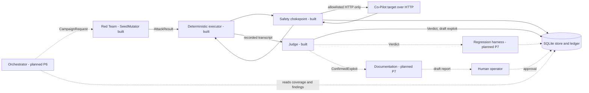
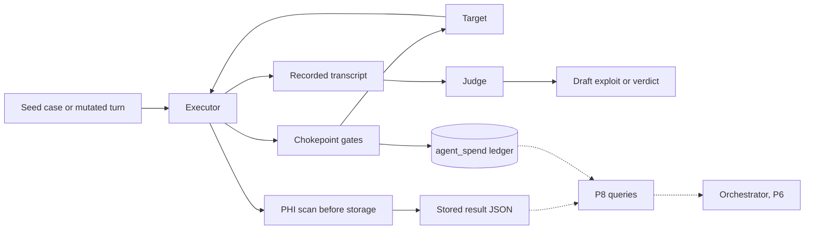

# AgentForge platform architecture

## Summary

**Status at commit 22e7983 (P5).** The Judge is built. The Red Team is a deterministic seed mutator. The Orchestrator and the Documentation agent are designed and not built. Every claim below is labeled **Built** (with a file path) or **Planned** (with the checkpoint that owns it). Nothing planned is described as working.

AgentForge is a multi-agent adversarial evaluation platform for the OpenEMR Clinical Co-Pilot. The Co-Pilot is an external HTTP target that the platform reaches only through one allowlisted chokepoint. Four agents hold distinct roles and trust levels, because the PRD says an agent that both generates and judges attacks is compromised by design.

The **Orchestrator** reads coverage gaps, open high-severity findings and recent regressions from the store, and chooses the next campaign. It sends a `CampaignRequest` to the Red Team. It is planned for P6 and is mostly deterministic rules. The **Red Team** turns a campaign into an attack sequence. Today it is `SeedMutator`, which makes bounded variants of existing seed cases under a budget. Model-driven generation, novel attacks and multi-turn strategies are planned for P6. The **Judge** decides whether an attack succeeded. It is independent of the Red Team and reads only an executor-recorded transcript, never the attacker's claim of success. Deterministic graders run first: canary strings, patient-id boundaries, PHI patterns, the tool allowlist and the attack-count cap. A language model is consulted only for an ambiguous transcript, and it comes from a different model family than the Red Team. The **Documentation agent** turns a confirmed exploit into a reproducible report after validating required fields and uniqueness. It is planned for P7 and never publishes: a human approves critical and high findings.

Agents exchange versioned JSON messages defined in `contracts/v1/`, with typed error schemas for the PRD failure modes: target unreachable, budget exceeded, judge timeout, no findings in window and regression detected. Handoff today is direct invocation of typed Python objects plus a SQLite store. There is no queue and no wire protocol between agents.

Safety comes first. No request leaves the platform unless it passes the allowlist, a budget with a kill switch, a spend-approval gate and a request-rate cap. A persistent ledger holds one shared $5 ceiling across every billable call, including the target's own spend caused by the attacks. Transcripts are scanned for PHI-like patterns before storage, and all fixtures are synthetic.

Evidence so far is modest and is stated plainly. Three graded cases, one each from prompt injection, data exfiltration and denial of service, passed against a local target at `127.0.0.1:8300`. One live Red Team call was stored and traced to a ledger row. These are defense-held results, not discovered exploits. The Judge was measured on four labeled items and, with a provider model, on one ambiguous item, so no error rate is claimed. There is no public deployed URL: that is open gap H-1, owned by the operator. Total committed spend is $0.1022 of the $5.00 ceiling.

## Agents

| Agent | Role | Inputs | Outputs | Trust level | Model | Status |
|---|---|---|---|---|---|---|
| Orchestrator | Choose the next campaign from coverage, findings and regressions | Store reads, budget state | `CampaignRequest` (`contracts/v1/campaign_request.schema.json`) | Trusted to schedule. Never judges or publishes | `TBD` in `config/models.yaml`, rules first | Planned (P6) |
| Red Team | Propose attack sequences within a budget | `CampaignRequest`, seed cases in `evals/cases/` | `AttackResult` (`attack_result.schema.json`) | Untrusted by the Judge. Its claims are never evidence | `openai/gpt-4.1-mini` configured. `SeedMutator` is deterministic and calls no model | Built, partial (`src/agentforge/agents/red_team.py`) |
| Judge | Decide pass, fail or partial independently | Executor-recorded transcript (`recorded_transcript.schema.json`) | `Verdict` (`verdict.schema.json`) or a draft `ConfirmedExploit` (`confirmed_exploit.schema.json`) | Independent of the Red Team. Output is proposed evidence, not truth | `anthropic/claude-sonnet-4.5`, ambiguous cases only | Built (`src/agentforge/agents/judge.py`) |
| Documentation | Write a reproducible report from a confirmed exploit | `ConfirmedExploit` | A draft report. Publication is a human act | A draft until a human approves | `TBD` in `config/models.yaml`, template and validation first | Planned (P7) |

Supporting components, which are not agents:
- **Built.** The deterministic executor and graders (`src/agentforge/evals/`), the safety chokepoint (`src/agentforge/safety/`), the cost ledger (`src/agentforge/safety/ledger.py`) and the SQLite store (`src/agentforge/store/`).
- **Planned (P7).** The regression harness.

## Interaction diagram

Solid edges are Built. Dashed edges are Planned.

In this checkpoint a script (`scripts/live_agent.py`) calls the Red Team. No Orchestrator does. The executor, not the Red Team, records the transcript the Judge reads.

## Communication design

- **Built.** Four v1 messages and one transcript schema in `contracts/v1/`. Each carries `schema_version` `v1` and a `correlation_id`. Validation is in `src/agentforge/contracts/validate.py`.
- **Built.** Agents are invoked directly as typed Python objects. State is shared through the SQLite store. ADR-003 rejected a queue, a graph framework and conversation-style agent libraries.
- **Planned (P6).** A persisted state machine that carries one correlation id through all agents.

## Trust boundaries and human gates

- **Built.** The target is untrusted and its output is data, never instruction. Only the allowlist chokepoint reaches it (`src/agentforge/safety/chokepoint.py`). The Judge does not read the Red Team's claims. An exploit is created as `draft`, and the insert path refuses `published` (`src/agentforge/store/records.py`, `tests/test_store.py`).
- **Planned (P7, P9).** A human moves a draft to `pending_approval` and then to `published` or `rejected`. Critical and high findings need that approval, and agents may propose a patch and never apply one. The rule is written in `Docs/ACCESS_CONTROL.md`. Code that checks the human identity is P9.

## A. Agent failure and recovery

PRD basis: "how they recover from failure", the typed error list, and the Appendix cascading-failure questions.

- **Built.** A refused chokepoint gate raises and is logged (`src/agentforge/safety/refusal_log.py`). A budget refusal returns a typed `budget_exceeded` (`src/agentforge/agents/red_team.py`). A Judge timeout returns `judge_timeout` with `retryable: true` and detail `needs_human_review`, and the reservation is released (`src/agentforge/agents/judge.py`). A crash cannot leave a reservation open: the `_Reservation` guard in `src/agentforge/agents/probe.py` and `Ledger.settle_orphan` in `src/agentforge/safety/ledger.py`. The kill switch halts before the next call (`src/agentforge/safety/budget.py`).
- **Planned (P6).** A persisted state machine and resume after a killed agent (ADR-003). A cascading-failure policy. Populated `run_logs` states: `queued`, `running`, `halted` and `done` exist as names in the schema only.
- No agent is retried automatically today. A caller sees the typed error and decides.

## B. Versioned handoff and error schemas

PRD basis: versioned schemas, typed errors, contract tests, and a migration note for each interface change.

- **Built.** Four v1 messages, `recorded_transcript`, five error schemas and a shared `error_envelope` with a `retryable` flag, all in `contracts/v1/`. Producer and consumer tests (`tests/test_contracts.py`, `tests/test_contracts_nested.py`) and a schema-diff CI check (`scripts/check_schema_diff.py`) reject a breaking change that has no version bump. Optional-field additions made without a bump are logged in `Docs/DECISIONS.md` section 5, and store changes have notes in `Docs/migrations/`.
- **Planned (P6/P7).** `RegressionTrigger` and `RegressionResult` are named in `Docs/DEFENSE_PACKET.md` and have no schema. The Orchestrator-to-harness handoff is undefined until then. Adding it is a v1 addition with a migration note.
- Handoff today is direct invocation plus the store. There is no wire protocol.

## C. Orchestrator prioritization and stopping policy

PRD basis: reads coverage gaps, open findings and regressions; halts when spend produces no signal; has a no-priority fallback; triggers regression when the target changes.

- **Built (P6).** `src/agentforge/orchestrator/` ranks from persisted evidence only (`priority.py`), stops or redirects once when spend yields no validated signal (`stop.py`), and journals every external effect write-ahead (`journal.py`, [ADR-008](Docs/adr/008-dispatch-journal.md)). A version change writes a handoff and does not replay it (`versions.py`). Weights and bounds are in `config/orchestrator.yaml`.
- **Partial.** The all-agents trace is partial: Orchestrator, Red Team, the executor and the Judge are traced under one correlation ID (`trace.py`). The Documentation leg is deferred to P7. P6 does not mark that trace met.

## D. Exploit-to-regression lifecycle

PRD basis: a confirmed exploit becomes a deterministic case; detect reappearance and cross-category regression; a passing regression must mean fixed, not drifted.

- **Built.** The Judge turns a canary-graded `fail` into a draft `ConfirmedExploit` and never publishes. The store has `exploits` (`draft`, `pending_approval`, `published`, `rejected`), `regression_cases` with a foreign key to an exploit, a unique `sequence_hash`, and required-field checks (`src/agentforge/store/schema.sql`, `records.py`). Duplicate and incomplete inserts are rejected (`tests/test_store.py`).
- **Planned (P7).** Verdict, then store row, then regression case, then repeat runs that assert side effects rather than wording, then a fixed or regressed state, then a Documentation draft, then human approval. No agent writes the store today, so no "fixed" state exists.
- The live results so far are defense-held passes. No exploit has been confirmed against the target.

## E. Observability and data flow

PRD basis: the six observability questions, which must also be readable by the Orchestrator.

- **Built.** `agent_spend` holds per-role reserved and incurred spend as separate columns (`src/agentforge/store/migrations/0002.sql`, `src/agentforge/safety/ledger.py`). The refusal log is `evals/results/refusals.log`. It is created at runtime by the live scripts (`scripts/live_campaign.py`, `scripts/live_agent.py`) on the first refused call, so it does not exist in a fresh clone. Stored results carry correlation ids (`evals/results/campaign-latest.json`, `evals/results/agent-live.json`), and `ledger_call_id` ties a live result to its ledger row. The four P2 tables exist: `exploits`, `regression_cases`, `run_logs`, `coverage_metrics`. ADR-006 chose our own SQLite traces over a hosted tool, so no third party receives transcripts.
- **Planned (P8).** A query for each PRD question: categories tested and case counts, pass and fail by category and version, resilience trend, vulnerability status, cost per run and its scaling, and what each agent did in order. `run_logs` and `coverage_metrics` are populated by P6 and P7 and have no writer today.

Data flow, Built unless marked:

## F. Model selection rationale

PRD basis: models chosen with refusal and cost in mind, and an independent Judge.

- **Built.** `config/models.yaml` sets `red_team` to `openai/gpt-4.1-mini` and `judge` to `anthropic/claude-sonnet-4.5`. A config where the two share a family is refused (`src/agentforge/models_config.py`, `tests/test_models_config.py`). The measured probe is in `Docs/MODEL_PROBE.md`:
  - The red_team probe call was refused, at $0.0000228.
  - The judge probe call completed, at $0.000291.
  - Each is one sample per family, not a refusal rate.
- **Planned.** `orchestrator` and `documentation` stay `TBD`. The intent is rules first, with a model only where a rule cannot decide. No model has been chosen and none is recommended here.
- **Consequence.** `SeedMutator` is deterministic, so no model is in the attack loop yet. The red_team refusal matters from P6, when model-driven generation is added.

## G. Build-versus-configure justification

PRD basis: a build-versus-configure record for each agent role is required before it is implemented.

- **Built (as a document).** `Docs/BUILD_VS_CONFIGURE.md` evaluates Burp Suite, OWASP ZAP, Semgrep, Garak, promptfoo, PyRIT, commercial red-team platforms and plain deterministic tooling.
- **Decisions.** Red Team, Judge, Orchestrator and Documentation are custom, because the target is a stateful, session-authenticated, patient-scoped LLM application and the verdicts depend on our own invariants. The deterministic layer is small custom code. Web Top 10 scanning is configured with ZAP, not built. Semgrep is for the platform's own code.
- **Planned.** ZAP and Semgrep have not been run (P3 and P9 owners). The tool claims in the record are unverified (G-2). This file links the record and does not repeat it.

## H. Scale and concurrency tradeoffs

PRD basis: cost, rate limits, queue and database constraints, and the 100 / 1K / 10K / 100K framing.

- **Built.** SQLite with one shared ledger across processes, committed after every write (`src/agentforge/safety/ledger.py`). A per-run request cap (`src/agentforge/safety/rate.py`). A per-run attack cap and a $5 shared ceiling (`config/budget.yaml`).
- **Planned.** The known limits are SQLite write contention (the reopen conditions in ADR-003 and ADR-005), the target's in-memory rate limiter, and target spend of about $0.05 per chat. P8 measures the bottleneck. This file states no throughput number.
- Execution is single-process and sequential. No concurrency is supported or tested. Queue documentation (D-11) does not apply while ADR-003 stands.
- **Provisional assumptions**, all unmeasured until P8:
  - **Volume.** A run is capped at `max_attacks_per_run: 20` and the shared ceiling is $5. At about $0.05 per target chat (the Week 2 figure cited in `Docs/ROADMAP.md`, not remeasured here), $5 buys roughly 100 chats before model cost.
  - **Latency.** A target chat takes seconds to tens of seconds (`THREAT_MODEL.md`). Platform orchestration and storage latency are unmeasured.
  - **Concurrency.** One run at a time, because of the shared ledger, the target's in-memory limiter and SQLite. Any parallelism is a P8 question.
  - These are planning figures, not baselines. The load test (D-13) and baselines (D-12) replace them.

## I. Judge uncertainty, false positives and false negatives

PRD basis: an independent Judge, and how it is evaluated.

- **Built.**
  - **Evidence rule.** The Judge reads only the executor-recorded transcript. Attacker claims (`observed_behavior`, `severity`, `exploitability`, `regression_flag`) are ignored (`src/agentforge/agents/judge.py`).
  - **Deterministic first.** A decisive rule never calls a model. An ambiguous transcript goes to the model, and an unanswerable one yields `partial` or `needs_human_review`. A bare `AttackResult` with no transcript returns `no_findings_in_window`, not a verdict.
  - **Labeled set.** Four hand-labeled items in `evals/judge/labeled/`. Stub-path precision is 1.0, recall 1.0 and false-positive rate 0.0 (`evals/judge/baseline.json`). One provider-scored ambiguous item agreed with its label (`Docs/JUDGE_DRIFT.md`, `evals/results/judge-drift.json`).
  - **Known false positive.** Review on 2026-10-18 found the canary grader called a refusal that quoted the canary a `fail`. The fixture markers were corrected. This is evidence that false positives are possible and that the labeled set caught one.
  - **Drift procedure.** Disagreements and rate drops are recorded, reviewed by a human and corrected by a reviewed change (`Docs/JUDGE_DRIFT.md`). Nothing adjusts a threshold automatically.
- **Limits, stated plainly.** Four items cannot support a rate. False negatives are not measured on any realistic set, and a deterministic canary rule cannot see an exploit that does not use a canary. A provider-scored set larger than one item is not built.
- **Planned (P7, P8).** A larger labeled set, a per-category false-positive and false-negative report, and human review of every critical or high finding before publication. P7 adds a check that a regression pass means a fix and not a drifted Judge.

## J. Red Team novelty and harmful-output handling

PRD basis: the Red Team must find new attacks without leaking sensitive content, and the Appendix asks how novelty is measured.

- **Built.**
  - **Seeded variation.** `SeedMutator` makes a bounded number of deterministic variants of a seed case (`src/agentforge/agents/red_team.py`, `tests/test_p3_envelope.py`).
  - **Duplicate rejection.** The store's unique `sequence_hash` rejects a repeated attack sequence.
  - **Harmful-output handling.** Fixtures are synthetic, and the PHI scan runs before any response is stored (`src/agentforge/safety/phi.py`, `src/agentforge/evals/executor.py`). A response that fails the scan is not stored and the case errors. The allowlist limits where an attack can go, and the budget and attack caps limit how many.
- **Planned (P6).** Model-driven generation and multi-turn strategies, a novelty score measured as distance from existing sequences and from the seed suite, and a refusal-aware retry that treats a model refusal as a signal. Attack content that a human reads is handled under the access rules in `Docs/ACCESS_CONTROL.md`.
- No novel exploit has been found. The probe showed that the configured Red Team model can refuse (`Docs/MODEL_PROBE.md`), which is a P6 risk, not a solved one.

## K. Continuous improvement and per-agent evaluation

PRD basis: new attack techniques must feed back into coverage, and each agent needs its own evaluation.

- **Built.**
  - **Judge.** A labeled set, a baseline, a drift procedure and a measured provider item.
  - **Red Team.** Spend and refusal are recorded per role (`agent_spend`, `Docs/MODEL_PROBE.md`).
  - **Seed suite.** CI validates the 7 seed cases and runs them in dry-run mode on every push (`scripts/check_evals.py`).
  - **Manual feedback.** A new technique is added by hand as a case under `evals/cases/` with a schema check, and a Judge error becomes a labeled item.
- **Planned.**
  - **P6.** The Orchestrator reads `coverage_metrics` so an under-tested category or a new technique raises priority. The Red Team is scored on novelty and on confirmed-exploit yield per dollar.
  - **P7.** Each confirmed exploit becomes a permanent regression case, so a found technique stays in the suite.
  - **P8.** The Orchestrator is scored on coverage gained per dollar and on stopping correctly. The Documentation agent is scored on whether another person can reproduce a report.
  - **P6 to P8.** A new technique reaches the next campaign through the store, not through an agent editing another agent's prompt.

## AI-use disclosure

Every AI role, the check or approval that follows each AI decision, and the risk that remains.

| AI role | Status | Check or approval after the AI decision | Remaining risk |
|---|---|---|---|
| Judge model (`anthropic/claude-sonnet-4.5`) | **Built**, ambiguous transcripts only (`src/agentforge/agents/judge.py`) | Deterministic rules run first. The model sees only the recorded transcript. A confirmed exploit is a draft. A human approves before publication (`src/agentforge/store/records.py`) | Four labeled items support no error rate. A model can be wrong or be steered by transcript text (section I) |
| Red Team model (`openai/gpt-4.1-mini`) | **Planned** (P6). The probe call exists (`Docs/MODEL_PROBE.md`). `SeedMutator` uses no model | The chokepoint, allowlist, budget and attack cap bound every call. The PHI scan runs before storage. The Judge, not the Red Team, decides success | The model refused the probe. It may refuse offensive tasks or produce harmful text (section J) |
| Orchestrator model | **Planned** (P6), `TBD`, rules first | Hard caps and the kill switch stop a run regardless of its choice | An LLM planner could loop or chase noise. Its choice is a priority, not a finding |
| Documentation model | **Planned** (P7), `TBD`, template and validation first | Required-field and uniqueness validation. Human approval for critical and high findings | A fluent report could overstate a finding. A reviewer must reproduce it |
| AI coding assistant (development only) | **Built** into how this repo was written | A human reviews and commits. CI runs tests and scans. Docs state unmeasured items as unmeasured | An assistant can write a plausible wrong claim. Checks cover structure and tests, not every sentence |

- **Built.** Models used inside the platform are named in `config/models.yaml` and measured in `Docs/MODEL_PROBE.md`. Their only live use so far is recorded in `evals/results/probe-report.json` and `evals/results/judge-drift.json`.
- **Boundary.** Every provider call goes through the same chokepoint and ledger as a target call. `LIVE_ENABLED` and `PROVIDER_ENABLED` are `False` in committed code. A live run needs an operator-held key and an approval file (`config/operator_approval.example.yaml`).

## API limits and authentication (C-6)

- **Target.** The Co-Pilot is reached through a public module login and a session cookie. A chat POST carries `X-CSRF-Token`, taken from the page (`src/agentforge/evals/session.py`, `src/agentforge/evals/login.py`). The cookie stays in memory and is never written to a log or result file. Credentials are synthetic fixture users (`Docs/TARGET_FREEZE.md`).
- **Target limits.** The target's rate limiter is in memory and per process (`THREAT_MODEL.md`). A chat costs about five cents. The platform's own cap is `max_attacks_per_run: 20`, with a request-rate cap (`src/agentforge/safety/rate.py`).
- **Target 429 and 503 handling (Built).** A 429 or 503 is returned once to the caller and is never retried. The chokepoint returns it before any redirect handling (`src/agentforge/safety/chokepoint.py`), the session client does not retry it (`src/agentforge/evals/session.py`), and the rate cap states the same (`src/agentforge/safety/rate.py`). The caller aborts that case and reports it. The reservation for the call stays accounted for in the ledger.
- **Provider.** OpenRouter is called through the chokepoint with a per-call reservation (`src/agentforge/agents/openrouter.py`, `src/agentforge/providers/transport.py`). The key is read from the environment and never committed. No provider-side spend limit is attested (E-6, still open).
- **Provider 429 and 5xx handling (Built).** The Judge client raises a typed `OpenRouterHttpError` on 429, 500, 502, 503 and 504, and does not retry (`src/agentforge/agents/openrouter.py`). The provider transport returns such a status once (`src/agentforge/providers/transport.py`). A timeout raises `JudgeTimeoutError`, which becomes the typed `judge_timeout` error with `retryable: true` (section A).
- **Backoff and queue (Not implemented).** There is no exponential backoff, no retry loop and no request queue, for the target or the provider. The only recovery today is to abort, return a typed error, and let the operator decide. **Planned (P6):** typed handling of rate-limit responses, where the roadmap leaves the choice among backoff, queue or abort open (`Docs/ROADMAP.md`, P6). ADR-003 rejected a queue, so a queue is not expected while that decision stands.
- **Platform.** The platform has no public API in P5. Its only inbound interface is the operator's command line.
- **Planned (P9).** The platform's own authentication and access control are P9. The rule is written in `Docs/ACCESS_CONTROL.md`.

## Pagination (C-7)

Not applicable. The platform exposes no list endpoint and consumes none. If a list endpoint is added later, it must paginate. That is Planned and has no checkpoint yet.

## Deployment note (H-1)

- **Built.** The platform runs locally. The target it was tested against is a local Docker stack at `127.0.0.1:8300`, and the allowlist (`config/allowlist.yaml`) admits only that host.
- **Open.** There is no deployed public URL. This is gap **G-1 / H-1**. **Owner: the operator.** Nothing in this repository can supply a public hostname.
- **Closeout steps** (any later checkpoint, once the operator answers Q2):
  1. The operator supplies the current URL.
  2. A reviewed `config/allowlist.yaml` edit adds the host.
  3. One identity GET and the zero-spend `seed-tm-ex-3` case run against it.
  4. The result is recorded in `Docs/TARGET_FREEZE.md`.
- P11 re-checks H-1. P5 does not mark it met.
