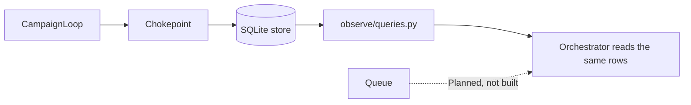

# ATO-style evidence packet

Separate from [ARCHITECTURE.md](../ARCHITECTURE.md) and from [DEFENSE_PACKET.md](DEFENSE_PACKET.md). Q6 stays unconfirmed. This packet does not replace either document. It does not close H-1, E-6, or G-2.

## Architecture diagram

The diagram is the mermaid block under "Interaction diagram" in [ARCHITECTURE.md](../ARCHITECTURE.md). This packet does not draw a second one. Solid edges there are Built. Dashed edges are Planned.

## Data flow

Paths that exist today. Planned edges are labeled Planned. No queue is added (ADR-003, D-11).

## Auth model

A `Grant` and a non-blank `approved_by` are not authenticated principals. There is no identity provider, session, or proof the named person is present ([ACCESS_CONTROL.md](ACCESS_CONTROL.md)). Q3 stays open. `MODULE_SIGNING_SECRET` and `OAUTH_TOKEN` are unread and are not a credential class in use (`tests/test_p9_credentials.py`).

| Component | Target access | Provider access | Credential class | Enforcement |
|---|---|---|---|---|
| Orchestrator | None. Starts a dry run only | None | None | `scripts/orchestrate.py` refuses `--live` while `LIVE_ENABLED` is false |
| Red Team, Judge, Documentation | None directly | None directly | None. Agent modules do not read secrets | `tests/test_p9_credentials.py` |
| Session client | Allowlisted HTTP only, after identity check | None | Fixture password, read only in `evals/session.py` | `src/agentforge/safety/chokepoint.py`, `src/agentforge/safety/allowlist.py`, `src/agentforge/safety/identity.py` |
| OpenRouter client | None. Cannot authorize a target request | OpenRouter only, and only while `PROVIDER_ENABLED` is true | `OPENROUTER_API_KEY`, read only in `agents/openrouter.py` and `agents/probe.py` | `src/agentforge/safety/chokepoint.py` `PROVIDER_ENABLED`; `tests/test_p9_credentials.py` |
| Harness and store | No HTTP | No HTTP | In-process `Grant` issued by `CampaignLoop` or the suite | `src/agentforge/store/access.py`, [ACCESS_CONTROL.md](ACCESS_CONTROL.md) |
| Operator process | The process that holds the store | Same process, only through the OpenRouter client | Approval file label, not a login | [ACCESS_CONTROL.md](ACCESS_CONTROL.md) |
| Scheduled workflow | None | None | None. `contents: read`, no secrets | `.github/workflows/regression-schedule.yml` |

## Dependency list

[ato/dependencies.txt](ato/dependencies.txt). Each line is a pin from [pyproject.toml](../pyproject.toml) or [requirements-dev.txt](../requirements-dev.txt), marked `runtime` or `dev`. Python is `>=3.12,<3.13`. No package was resolved from the network.

## Vulnerability scan

[ato/self-scan.txt](ato/self-scan.txt). The date line is the first line `scripts/self_scan.py` printed when that run started. It is not typed into this packet. Command `python scripts/self_scan.py`. Exit code 0. This is one local run of the existing script, not a second gate, and not a ZAP or Semgrep scan. G-2 stays open.

## Eval evidence

- [evals/results/campaign-latest.json](../evals/results/campaign-latest.json): three local graded passes. Not a public-URL run.
- [evals/results/agent-live.json](../evals/results/agent-live.json): one live agent call.
- [evals/results/judge-drift.json](../evals/results/judge-drift.json): one scored item, not a rate.
- [evals/results/baseline-p8.json](../evals/results/baseline-p8.json): `satisfies_d13` is false. Not a load test.

## Record of the 2026-10-19 key-limit episode

Not a drill. Facts below are only those stated in [PROGRESS.md](PROGRESS.md) and [MODEL_PROBE.md](MODEL_PROBE.md).

- Date: 2026-10-19.
- The shared OpenRouter key had exceeded its own provider-set total limit (`$250.20` of `$250.00` used, no reset).
- The first probe and Judge runs were refused with HTTP 403 and released at $0.
- The key owner then raised the limit, and the provider rows in the spend log were billed after that.
- `config/spend_limits.yaml` is still empty. E-6 stays open. This record is not a provider spend-limit attestation.
