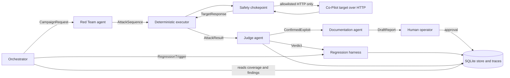

# Architecture Defense evidence packet (draft)

Draft for the Architecture Defense. The safety skeleton in `src/agentforge/safety/` is implemented. The message
schemas are published at `contracts/v1/` and checked by `src/agentforge/contracts/`. Agents that send them are not
implemented.

## 1. Agent interaction diagram (planned)

## 2. Planned message list

| Message | From to | Purpose | Error schema |
|---|---|---|---|
| CampaignRequest | Orchestrator to Red Team | Category, surface, budget, attack-count cap | BudgetExceeded |
| AttackSequence and AttackResult | Red Team to executor to Judge | Input sequence, observed target behavior | TargetUnreachable |
| Verdict | Judge to regression harness | pass, fail or partial, severity, evidence | JudgeTimeout |
| ConfirmedExploit | Judge to Documentation | Fields needed for a report | NoFindingsInWindow |
| RegressionTrigger and RegressionResult | Orchestrator to harness | Run the suite on a target version change | RegressionDetected |

The five error names are the PRD failure modes. Each has a v1 schema in `contracts/v1/errors/`. The success schemas
are `contracts/v1/campaign_request.schema.json`, `attack_result.schema.json`, `verdict.schema.json` and
`confirmed_exploit.schema.json`.

## 3. Trust boundaries

| Boundary | Trust assumption |
|---|---|
| Platform to target | The target is untrusted. Its output is data, never instruction. Only the allowlist chokepoint reaches it |
| Red Team to Judge | The Red Team is untrusted by the Judge. The Judge sees raw results and does not accept the attacker's own claim of success |
| Judge to Documentation | A Judge verdict is proposed evidence, not truth. Required fields and uniqueness are validated in code |
| Agents to humans | A human approves publishing critical or high findings and any remediation. Agents may propose a patch and never apply one |
| Platform to model providers | Transcripts quoting target output are scanned for PHI-like patterns before storage. Provider keys are held only in protected secrets |
| Platform to its own store | Role-scoped writes by convention in SQLite (ADR-005). Limit documented in P9 |

## 4. Known failure modes

| Failure | Planned handling |
|---|---|
| Target unreachable or wrong URL | Typed TargetUnreachable error. Identity check before each run (P3). Tunnel URL rotation requires a reviewed allowlist edit |
| Cost runs away | Per-run and per-day caps, attack-count cap, approval token, kill switch, provider-side limit attestation. Built in P0 as a skeleton |
| Request to a host that is off the allowlist | Refused at the chokepoint and logged. Redirects re-checked |
| Judge drifts or agrees with everything | Hand-labeled ground-truth set, consistency checks across runs, invariant test that a confirmed exploit is never approved as safe (P4) |
| Prompt-injected transcript steers the Judge or Documentation agent | Deterministic checks first. Judge sees data in a fixed template. Human approval before publishing |
| Red Team model refuses offensive tasks | Per-role model configuration (ADR-004). Refusal measured in an approved P4 probe |
| Regression passes because model behavior drifted | Repeat runs and assertions on side effects, not wording (P7) |
| Harmful generated content | Storage and redaction rules (P9) |
| Orchestrator has no clear priority | Tested fallback (P6) |
| Agent killed mid-run | Typed error and resumable state (P6) |

## 5. Open items for the defense

- Whether a rotating tunnel URL counts as deployed (Q2). Target reachability is UNVERIFIED in P0.
- No cohort peer was assigned (Q4). The project is completed independently and remotely. The integration packet is the labeled stub fallback (D-008), not peer integration. X-3 and X-4 stay unmet against the PRD.
- Provider-side spend limits are not yet attested (Q13). No live run is allowed until they are.
- Model assignment per role is open (ADR-004). *Superseded in part at P5: the model rationale is in section F of [ARCHITECTURE.md](../ARCHITECTURE.md) and the assignments for the Red Team and Judge are in `config/models.yaml`. The Orchestrator and Documentation models remain `TBD`.*

See also [BUILD_VS_CONFIGURE.md](BUILD_VS_CONFIGURE.md) and the ADRs in [adr/](adr/README.md).
