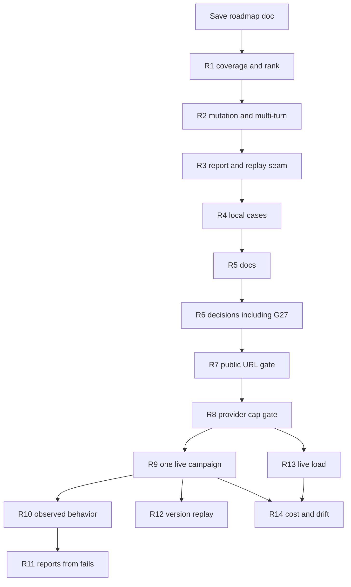

# R-series master remediation roadmap

Status: approved master roadmap. This file records future checkpoints. It does not implement them, approve a public URL, approve provider spend, or approve a live attack.

Acceptance standard: the original Week 3 PRD ("AgentForge: Adversarial AI Security Platform"). Gap IDs are the verified G1–G27 register. If this file disagrees with the PRD, the PRD wins.

R1–R14 below are checkpoint descriptions. Each gets its own later Plan, review, and Build. Saving this file does not start R1. A checkpoint must not be implemented inside another checkpoint's cycle.

## Priority order

Confirmed integration gaps come first because the PRD path is disconnected in code, independent of deployment.

1. **Confirmed integration** (R1–R3): coverage is never written, rank is discarded, mutation and multi-turn have no caller, regression replay requires a stub, and report export can label a real transcript as a fixture.
2. **Local evidence** (R4): missing case files and missing offline outcomes. Not public-target proof.
3. **Documentation** (R5): stale claims. Does not close unmet rows.
4. **Interpretations** (R6): decisions only. Includes the debatable store-level PHI requirement (G27). No authenticated principals, database roles, SQL timer, or store-level PHI scan unless a decision later requires one.
5. **Operator gates** (R7–R8): blocked until deployment is explicitly approved, then a provider cap.
6. **Live proof, split** (R9–R14): each needs its own approval to run, and none starts before R7 and R8.

R1–R6 need no network spend. R7 does not start without deploy approval. R8 does not start without spend-cap approval. R9–R14 do not start without an explicit live-run approval for that checkpoint, and they do not start before R7 and R8.

## Preservation for every later cycle

- Keep dry-run as the default in [scripts/orchestrate.py](../scripts/orchestrate.py). `--live` still returns 2 while `LIVE_ENABLED` is false until the R9 cycle, and only then if every existing gate passes.
- Keep [scripts/regress.py](../scripts/regress.py) refusing `--live`. A replay seam must not become an unattended network caller.
- Do not change [src/agentforge/safety/chokepoint.py](../src/agentforge/safety/chokepoint.py) `LIVE_ENABLED`, [config/allowlist.yaml](../config/allowlist.yaml), or empty [config/spend_limits.yaml](../config/spend_limits.yaml) before the gated cycle that owns that file.
- Do not rewrite fixture reports so they claim a live finding. [scripts/check_reports.py](../scripts/check_reports.py) requires `Live target: no` in those files. Change that check only in the cycle that writes a report from a real transcript.
- Do not edit the pinned target repo.
- Do not add a store-level PHI scan in R1–R5. Executor and content scans stay as they are.

## R1 — Coverage write and ranking use (G7, G8)

**Class:** confirmed integration. G7 and G8 land in one cycle. Writing coverage without using rank still leaves the first attack on the request category. Using rank without writing coverage still scores an empty table.

**Scope for that cycle's plan:**

- After a graded result in [src/agentforge/orchestrator/loop.py](../src/agentforge/orchestrator/loop.py), call `coverage_from` (lines 489–505).
- Stop discarding `next_request` in `_ordinary` (lines 168–176). Use `rank` in [src/agentforge/orchestrator/priority.py](../src/agentforge/orchestrator/priority.py) when the campaign is not pinned to an explicit category.
- Keep the rule that an explicit request category is not overridden on the first attack of that request. A redirect after the stop policy may still move category.
- G9 is not this cycle. Whether the loop must call `answers` is decided in R6.

**Acceptance:** After one graded attack, `coverage_metrics` has a row for that category and version. A campaign with no explicit category attacks the highest-ranked gap. Existing redirect tests still pass.

**Verification:** Orchestrator tests only. No live client.

## R2 — Mutation and multi-turn callers (G10, G11)

**Class:** confirmed integration. Independent of a public URL. A live run today would not enter these modes.

**Scope for that cycle's plan:** `run` defaults to `mode="novel"`. `_attack_until_stop` loads a parent only when `mode == "mutation"` (lines 214–216). Add a caller that stays off unless selected:

- `mutation` only when a Judge `partial` exists and `load_parent` accepts it.
- `multi_turn` only when the case or campaign requests more than one turn. Do not change novel `_turn_limit`.
- Dry-run flags in [scripts/orchestrate.py](../scripts/orchestrate.py) must not set `LIVE_ENABLED` or open a socket.
- `--variant-campaign`'s synthetic partial is not a real finding.

**Acceptance:** A dry-run with a stored `partial` calls `generate(..., mode="mutation")` once. A two-turn seed uses `multi_turn` and is not collapsed to one turn. Novel default stays one turn. `tests/test_p6_variants.py` still passes.

**Verification:** `ScriptedModel` and `FakeTarget` only. No provider call.

## R3 — Report truthfulness and regression replay seam (G12, G13)

**Class:** confirmed integration. Does not produce three reproducible findings and does not send live traffic. Those are R11 and R12.

**Scope for that cycle's plan:**

- [src/agentforge/agents/documentation.py](../src/agentforge/agents/documentation.py) line 129 always writes `Live target: no`. Tie that sentence to the transcript source. Fixture drafts keep the current sentence.
- Call `write_report_markdown` when a confirmed exploit is drafted and a reports directory is set. A missing directory must not fail a dry-run. The SQLite draft remains the record.
- `_replay_pending` (lines 342–355) halts when `stub` is `None`. Add a seam that can replay through the existing chokepoint client, still default-deny, still identity-checked, still refused while `LIVE_ENABLED` is false. Stub replay stays the default.
- Do not add `--live` to [scripts/regress.py](../scripts/regress.py).

**Acceptance:** A fixture render still says `Live target: no`. A render flagged as a real transcript does not. A pending handoff with no stub still halts rather than skipping cases. A fake chokepoint client can run the suite without a socket. `regress.py --live` still refuses.

**Verification:** Existing regression tests plus one fake-client seam test. No network.

## R4 — Local attack-suite evidence (G4, G3 local half, G18)

**Class:** evidence. Does not close the PRD sentence that tests run against the deployed target. That is R10.

**Scope for that cycle's plan:**

- Add cases for items the PRD names and the threat model marks applicable, and that have no file in `evals/cases/`: A04, A09, LLM02, LLM06, LLM08, and TM-EX-1. Map each in the dataset.
- Do not reopen A06, LLM05, A10, or the A03 narrowing. Those are R6.
- Store offline outcomes for the new cases and for `tm-pi-2`, `tm-pi-3`, `tm-ex-2`, and `tm-ds-3`.
- Leave Burp, ZAP, Semgrep, Garak, and commercial-platform claims in [BUILD_VS_CONFIGURE.md](BUILD_VS_CONFIGURE.md) unverified unless that cycle actually runs a tool.
- Do not invent a second Judge version or fill `TBD` model rows. Those are R6 and R14.

**Acceptance:** Every new case has an OWASP id, a category, and a stored offline outcome. Previously unstored seed ids have outcomes. Docs do not claim a tool was run if it was not.

**Verification:** Offline harness only. No `--live`, no provider key.

## R5 — Documentation alignment (G19, G20, G23 wording, G24 wording)

**Class:** documentation.

**Scope for that cycle's plan:**

- Replace stale "agents are not implemented" lines in [DEFENSE_PACKET.md](DEFENSE_PACKET.md) with the scripted-agent and `contracts/v1/` facts. Keep failure modes that are still true: no public URL, no live campaign.
- Keep [ATO_PACKET.md](ATO_PACKET.md) honest that grants are not principals. Do not expand the incident note unless R6 says the PRD requires a postmortem.
- Stop [src/agentforge/evals/loadtest.py](../src/agentforge/evals/loadtest.py) from describing session reuse as an unapplied fix when [LOAD_TEST.md](LOAD_TEST.md) says it is already in the harness. Do not set `satisfies_d13` true for a stub. `evals/results/d13-load.json` stays `zero_cost_stub: true`.
- Keep the `$0.05 * n` term in [COST_ANALYSIS.md](COST_ANALYSIS.md) labeled as a reservation, not a measured target bill.

**Acceptance:** `scripts/check_architecture.py` and `scripts/check_links.py` pass. No doc says the stub load test or the three fixture reports satisfy the live PRD sentences. Traceability rows owned by R7–R14 stay open.

**Verification:** Link and architecture checks, plus a diff review. No live run.

## R6 — Interpretation decisions (G27, G9, G14, G15, G16 dashboard reading, G17 mechanism, G21)

**Class:** decision record only. G27 is here, not in an engineering checkpoint. The PRD requires privacy-sensitive data to be controlled. Requiring [src/agentforge/store/records.py](../src/agentforge/store/records.py) itself to call `require_clean` is a stricter reading. The scan already exists on the executor and content paths.

**Scope for that cycle's plan:** Dated entries in [DECISIONS.md](DECISIONS.md), each citing the PRD sentence, the reading, and what will not be built:

- G27: executor and content scans satisfy the privacy sentence unless this decision explicitly requires a store-boundary scan. Default proposal: do not add that scan.
- G9: human-facing queries satisfy "the six questions are queryable." The loop need not call `answers`.
- G14: a non-blank approver label plus the YAML gate satisfies critical/high publication and remediation approval. No authenticated principal.
- G15: in-process `Grant` plus the documented SQL-owner limit satisfies "define who writes." No database roles.
- G16: bounded cost is the hard requirement. A provider cap is an operator gate (R8). Code may keep a YAML attestation instead of scraping a dashboard.
- G17: default-deny allowlist is the control. Branch protection is an operator setting.
- G21: the CI budget applies to `run_suite`. No separate SQL timer.
- A06, LLM05, A10, and the A03 narrowing stay interpretations, not new cases, unless this decision says otherwise.

**Acceptance:** Each entry names the PRD page, the reading, and what will not be built. No auth, role, timer, or PHI-scan code in this cycle. If a decision later requires a store scan, that becomes a new checkpoint after R6, not a silent addition to R1.

**Verification:** Review of the decision file. Traceability moves these IDs to "decided," not to "met" for any hard gap they do not close.

## R7 — Public target gate (G1, G2, G17 branch protection)

**Class:** operator blocker. Does not start without explicit approval to deploy. Does not send attack traffic.

**Scope for that cycle's plan, after approval only:**

- Record a public URL and the running pin in [TARGET_FREEZE.md](TARGET_FREEZE.md).
- Add that host, port, and path prefix to [config/allowlist.yaml](../config/allowlist.yaml) as a reviewed change. Default deny stays. A rotating tunnel URL is a new reviewed edit, not an automatic allow.
- Compare the running build to pin `9f03654` and record match or difference.
- Record whether branch protection is set. Do not invent a setting that was not checked.

**Acceptance:** Freeze doc has a URL. Allowlist contains that exact origin and no broader host. Identity check can see the synthetic-demo fingerprint. `LIVE_ENABLED` stays false in this cycle.

**Verification:** Freeze doc and allowlist diff. No attack traffic.

## R8 — Provider spend cap (G16)

**Class:** operator blocker. Does not start without explicit approval to set a provider cap. Blocks every billable call in R9–R14.

**Scope for that cycle's plan, after approval only:** Set a provider-side limit on the key that would be used. Fill [config/spend_limits.yaml](../config/spend_limits.yaml) so it matches that cap. Do not treat `authorize_spend` or an operator approval as a provider attestation. Refuse to proceed if the key is already over its cap.

**Acceptance:** The attestation names the cap, the key id (not the secret), and the date checked. The chokepoint still refuses an unattested key.

**Verification:** Config review and existing spend-limit tests. No campaign.

## R9 — One live multi-agent campaign (G6)

**Class:** live evidence. Does not start without explicit approval of this run, and only after R7 and R8. Does not include the 100-case load, the full result matrix, or report publication.

**Scope for that cycle's plan, after approval only:** One entry point that calls `RedTeamGenerator`, the chokepoint client, `RulesJudge`, and `draft_report` against the R7 URL. Replace the hard `--live` refusal in [scripts/orchestrate.py](../scripts/orchestrate.py) only when `LIVE_ENABLED`, an unexpired approval, the allowlist, and the identity check all pass. Dry-run stays the default. Caps, rate limit, and kill switch stay in force.

**Acceptance:** The stored trace shows four distinct roles against the public URL and pin. A gate failure stops before the next call. This cycle does not claim G3, G5, G12, or G23.

**Verification:** One bounded manual campaign. CI still makes no live or paid call.

## R10 — Observed behavior on the public target (G3 public half)

**Class:** live evidence. Own approval. After R9. Local R4 files do not close this row.

**Scope:** Run every case against the R7 deployment and store observed behavior, in at least three categories.

**Acceptance:** Result files name the public URL and pin. Every case id has an outcome from that deployment. A localhost file is not accepted as this checkpoint.

**Verification:** Manual run under the R8 cap. No CI live call.

## R11 — Reproducible reports (G5)

**Class:** live evidence. Own approval. After R9, and after R10 if the finding comes from the suite. Depends on a confirmed fail from the chain in R9 or R10.

**Scope:** If the judge confirms an exploit, write a report that is not labeled as a fixture, with reproduction steps and a fix-validation result. If the run finds no exploit, record that. Do not convert a pass into a finding. Three fixture reports do not count.

**Acceptance:** A published report cites a stored fail, a public URL, and a fix-validation result. Otherwise the checkpoint records "no confirmed exploit" and G5 stays open.

**Verification:** Report review against the stored transcript. No invented finding.

## R12 — Version replay on the deployed target (G12 public half)

**Class:** live evidence. Own approval. After R3's seam and R7. A second deployed version is an operator precondition, not something this cycle invents.

**Scope:** Replay through the R3 chokepoint seam against a new target version. Record a returning bug and a cross-category result if they occur. A missing seam still halts. Stub detection tests do not close this row.

**Acceptance:** The handoff names both pins and the public URL. Cases were not dropped. No `--live` flag on `regress.py`.

**Verification:** One approved replay. No unattended rerun.

## R13 — Live load measurement (G23)

**Class:** live evidence. Own approval. After R7 and R8. Independent of R9's single campaign, but it must not run on an unattested key.

**Scope:** 100 consecutive cases against the live target. Record orchestration time, LLM latency, and storage rate. Name the bottleneck and a change that would address it. Leave `evals/results/d13-load.json` as the stub artifact.

**Acceptance:** The new file has `zero_cost_stub: false`, a non-fake transport, and `satisfies_d13` true only under those conditions. The named fix matches the measured bottleneck.

**Verification:** One approved load run under the cap. CI does not run it.

## R14 — Measured cost and Judge drift (G24, G25)

**Class:** live evidence. Own approval. After at least one billable run (R9 or R13) for cost, and after a second graded version for drift. R12 can supply that version if it ran; this cycle must not fabricate one.

**Scope:** Replace the reservation term in the cost doc with measured target spend when the provider bill exists. Keep unlabeled projections out. Add a second Judge version to the drift file only from a real second run.

**Acceptance:** Incurred, verified, and projected figures are labeled separately. Drift evidence names two versions. A single-item file is not rewritten to look like a rate study.

**Verification:** Ledger against the provider bill. No new attack beyond the already approved runs unless this cycle's approval says otherwise.

## Not in this roadmap

- Cohort submission items: demo video, social post, deadlines.
- Implementing store-level PHI, authenticated approvers, database roles, or a SQL timer inside R1–R5.
- Treating localhost stub runs as closing G1, G5, or G23.
- A single implementation plan that builds more than one checkpoint.

## Cycle rule

Creating this file does not start R1. After this file exists, each of R1–R14 is a separate Plan, review, and Build. A cycle may mark only its own gaps. R1–R3 may say "wired, not live." R4 may say "local evidence." R5 may say "doc corrected." R6 may say "decided." Only R9–R14 may mark a live-target row met, and only with files from that checkpoint's run.
