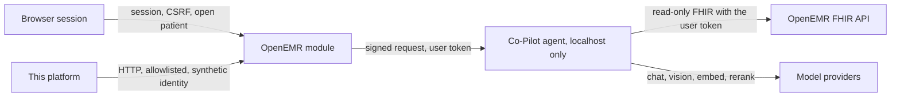

# Threat model: Clinical Co-Pilot

Living document for checkpoint P1. It maps the attack surface of the Co-Pilot and of this platform. It is not an
attack suite: cases come in P3 and must reference the IDs defined here.

## Summary

The Co-Pilot answers a physician's question from the open chart, an uploaded lab PDF or intake form, or a small
guideline corpus. Only the OpenEMR module is public. The agent listens on localhost and the deploy script fails if it
becomes reachable through the tunnel, so every attack starts as a logged-in session. A direct agent API call is a
different surface and out of scope.

Six categories cover the surface the PRD names. The highest risk is indirect prompt injection through upload
(TM-PI-2). An uploaded PDF is rendered and handed to a vision model whose output becomes stored facts, and those
facts are later placed in the prompt of a second model call. Both prompts say document text is data, not
instructions, and a verifier keeps only claims whose numbers and dates appear in a cited quote. None of that has
been measured against an adversarial document, and a vision model is the component least able to separate a printed
instruction from a printed lab value. Cross-patient exposure (TM-EX-2) is next, because the impact is another
patient's chart. OpenEMR itself returns any patient to any clinician token, which the target measured and recorded,
so the only patient-level control is the agent's own CareTeam check, re-run on every tool call and before any cached
result is served. It fails closed, but it trusts CareTeam membership, and anyone who can edit care teams changes who
is admitted. Authorization bypass (TM-EX-3) and privilege escalation (TM-ID-1) sit on that same control. Cost
amplification (TM-DS-3) matters separately: one chat costs about five cents and an upload adds a vision call of up
to thirty seconds, so a modest scripted session spends real money. The target's rate limiter is in memory and per
process, so it survives neither a restart nor a second instance.

Two facts shape how to test. The target's defenses are instructions to a model plus deterministic checks after it,
and an instruction is not a control until it is measured. The verifier, the tool allowlist and the step caps are
real code and are cited below, but present in code is not the same as holds. And the platform can poison itself: a
transcript quoting a successful injection is exactly what the Judge and the Documentation agent will later read, so
a compromised target can compromise the thing judging it (TM-PL-1, TM-PL-2). That is why the Judge's first layer is
deterministic and why a human approves publication.

Coverage is ranked by clinical impact, then by whether the defense is unverified, then by whether a deterministic
check can grade the case. First for P3, in order: indirect injection through upload (TM-PI-2), cross-patient access
(TM-EX-2), authorization bypass (TM-EX-3), cost amplification (TM-DS-3), direct injection (TM-PI-1) and multi-turn
injection (TM-PI-3). Six, against a floor of three. Tool misuse and state corruption rank lower because the code
already constrains them, and they are covered once the higher-risk cases exist. Nothing here is a test result. No
request was made to the running target, and every defense below comes from reading code, not from running it.

## Scope and method

- **Target.** `Sabeehq11/openemr-base-clean` at `9f036541cf95e896db065e0c652afb75627b03c2`, the pin recorded in
  [Docs/TARGET_FREEZE.md](Docs/TARGET_FREEZE.md). The platform reaches it only over HTTP, as a synthetic fixture
  identity through the public module ([ADR-001](Docs/adr/001-repo-strategy.md),
  [ADR-002](Docs/adr/002-target-access.md)).
- **Evidence labels.** "By code reading" means the file was read at that SHA and the behavior is what the code says.
  It does not mean the behavior was observed at runtime. "UNVERIFIED" means it was not checked at all. Runtime
  confirmation is P3, and P3 is also the first point at which this repo makes any request to the target.
- **What changed to make the target testable.** Nothing, by this repo. [Docs/TARGET_FREEZE.md](Docs/TARGET_FREEZE.md)
  records the operational caveats: the tunnel URL rotates, routing to the real model is a git-ignored config, and
  the running stack may differ from the pinned SHA.
- **Out of this document.** Exploit payloads, reproduction steps and verdicts. Those are cases, and cases are P3.

## System and trust boundaries

| Boundary | What crosses it | Trust assumption |
|---|---|---|
| Browser to module | Question text, a file, a document id and page | Untrusted. Authority comes only from the PHP session |
| Module to agent | A signed body plus the user's own token | The signature proves integrity, never authorization |
| Agent to OpenEMR FHIR | Read-only GETs with the user's token | OpenEMR enforces scope, not the patient. The agent adds the patient check |
| Agent to model providers | Prompts, page images, queries | Provider output is data. It is verified before display |
| Platform to target | HTTP to the public module only | The target is untrusted. Its output is never an instruction to an agent here |

## Target-specific surfaces

| Surface | Where | Why it matters |
|---|---|---|
| PDF and intake upload | Module `upload.php`, agent `app/w2/ingest.py`, `app/w2/vlm.py` | The only path where attacker-controlled bytes reach a model |
| Guideline retrieval | `app/w2/rag/`, corpus shipped in the image | Retrieved text is placed in a prompt |
| `/page` and the source viewer | Module `source.php`, agent `app/w2/api.py` `page` | Returns stored document bytes as an image |
| Signed gateway and nonce cache | `app/gateway.py`, `app/signing.py` | Integrity and replay control for every agent route |
| In-memory rate limiter | `app/gateway.py` `RateLimiter` | The only throttle on a verified caller |

## Categories

Each subcategory has the four attributes the PRD requires. Difficulty is a judgment from the code, not a measurement.

### TM-PI. Prompt injection

#### TM-PI-1. Direct injection

- **Attack surface.** The question field, posted to the module and forwarded as the user message.
- **Impact.** A crafted question makes the assistant ignore its rules: reveal another patient's data, invent a lab
  value, or give the dosing advice it is supposed to decline.
- **Difficulty.** Low to attempt, since any logged-in user can type it. Success is not guaranteed: the prompt forbids
  it and a verifier checks the output.
- **Existing defenses.** By code reading, partial. The system prompt says tool results are data and forbids diagnosis
  and dosing (`app/prompts.py`). Dose and diagnosis requests are declined by regex before any model call
  (`app/advice.py`, applied in `app/loop.py`). The verifier drops claims whose numbers or dates are not in a cited
  record (`app/verifier.py`). None of this is a control against wording that carries no checkable number.

#### TM-PI-2. Indirect injection

- **Attack surface.** An uploaded lab PDF or intake form, and text in the guideline corpus. The upload is rendered to
  page images, or sent as the native PDF when rendering fails, and given to the vision model (`app/w2/vlm.py`).
  Extracted facts are stored and later inserted into the Stage B prompt (`app/w2/synthesis.py`).
- **Impact.** A document instructs the vision model to emit values or instructions, which are then stored as the
  patient's facts and can steer the chat model on a later turn. That is a poisoned chart, and it persists.
- **Difficulty.** Low to attempt: upload is a normal feature. The vision model is the weak point, because it must read
  the very text that carries the instruction.
- **Existing defenses.** By code reading, partial and unverified against adversarial input. The vision prompt says
  document text is untrusted (`app/w2/vlm.py`). A row is kept only when its value appears inside its own quoted line
  (`app/w2/support.py`, `is_supported`). The Stage B prompt repeats the data-not-instructions rule, and its verifier
  requires every cited id to have been offered in that request (`app/w2/verify.py`). Nothing here detects an
  instruction that is also a plausible lab value.

#### TM-PI-3. Multi-turn injection

- **Attack surface.** The conversation. History is kept in memory and resent on each turn (`app/conversation.py`,
  `app/loop.py`).
- **Impact.** A sequence establishes a false premise, then a later turn acts on it, bypassing checks that look at one
  message.
- **Difficulty.** Moderate. It takes a session and it depends on the model following the earlier turn.
- **Existing defenses.** By code reading, partial. Authorization is re-checked at the start of every turn, and a
  cached tool result is re-authorized before it is served (`app/loop.py`). Nothing re-checks the content of earlier
  messages. The history is capped only by an idle timeout and a conversation count, not by a turn limit.

### TM-EX. Data exfiltration

#### TM-EX-1. PHI leakage

- **Attack surface.** Answers, degraded responses that include raw records, the source viewer, traces and logs.
- **Impact.** Patient data leaves the session: into a log, a trace, a model provider, or the platform's own store.
- **Difficulty.** Varies. The UI path is intended to show the open patient's data to their clinician, so the risk is
  leakage beyond that.
- **Existing defenses.** By code reading, partial. The model sees a placeholder instead of the patient's name, restored
  only at the output edge (`app/prompts.py`). Audit rows store identifiers and counts, never values (`app/audit.py`).
  Logs pass through a redactor for bearer tokens, emails, phones and SSNs (`app/logging_setup.py`). The dock inserts
  text with `textContent` (`public/assets/copilot.js`). No scan covers free text in an answer, and traces store the
  request outcome rather than a PHI review.

#### TM-EX-2. Cross-patient exposure

- **Attack surface.** Any tool call, document read, or stored-fact lookup that takes a patient identifier.
- **Impact.** A clinician, or a prompt that drives one, reads a patient they do not treat. This is the highest clinical
  impact in the model.
- **Difficulty.** Moderate. OpenEMR will not stop it, so only the agent's check stands in the way.
- **Existing defenses.** By code reading, one control, and it is the whole defense. `PatientAuthorizer` requires an
  active token, the read scopes, a matching subject, and membership of the patient's active CareTeam, read with the
  caller's own token (`app/authz.py`). The target's own proof records that OpenEMR returns any patient to any
  clinician token (`agent/AUTHZ_PROOF.md`). The Week 2 store queries are scoped by patient UUID (`app/w2/store.py`).
  The limit, stated in that proof, is that CareTeam membership is the access list, and a nurse added to a team is
  admitted. Two further weaknesses in the membership check are recorded as P3 candidates below.

#### TM-EX-3. Authorization bypass

- **Attack surface.** Forged or replayed signed requests, a tampered query string, a missing token, a caller-supplied
  patient id.
- **Impact.** A request served without a valid decision, which collapses into cross-patient exposure.
- **Difficulty.** High against the gateway, low against anything that skips it.
- **Existing defenses.** By code reading, layered. The module takes authority only from the session and checks CSRF
  (`public/chat.php`). The gateway rejects a bad signature, a stale timestamp, a reused nonce and a missing header,
  all as the same generic 401 (`app/gateway.py`, `app/signing.py`). Every tool call re-authorizes, and an error is a
  denial (`app/tools.py`). The Week 2 routes note that the query string is not signed and argue it is safe because the
  token, not the query, decides access (`app/w2/api.py`). That argument holds only while the authorizer does.

### TM-SC. State corruption

#### TM-SC-1. Conversation history manipulation

- **Attack surface.** The `conversation_id` returned to the browser and sent back on the next turn.
- **Impact.** A caller resumes or reads another user's conversation.
- **Difficulty.** Low to attempt, since the identifier is client-visible.
- **Existing defenses.** By code reading, addressed. The store returns a conversation only to the same user and the
  same patient; anything else opens a new one (`app/conversation.py`, `open`).

#### TM-SC-2. Context poisoning

- **Attack surface.** The snapshot of fetched tool results, kept per conversation for five minutes.
- **Impact.** A later turn answers from data fetched under an earlier, possibly broader, authorization.
- **Difficulty.** Moderate. It requires the snapshot to be served without a fresh check.
- **Existing defenses.** By code reading, addressed for authorization. A cache hit re-runs the decision before the
  envelope is returned (`app/loop.py`, `_fetch`). It does not address content: whatever was fetched is what is replayed.

#### TM-SC-3. Stored extraction poisoning

- **Attack surface.** Facts written to `w2.db` at upload and reread on later chats.
- **Impact.** One poisoned upload answers every later question about that patient until the document is replaced.
- **Difficulty.** Low, given a successful upload.
- **Existing defenses.** None found for the content. The store deduplicates by hash and scopes by patient
  (`app/w2/store.py`), which limits who can read it, not what it says.

### TM-TM. Tool misuse

#### TM-TM-1. Unintended tool invocation

- **Attack surface.** The model's tool calls inside the loop.
- **Impact.** A prompt drives a tool the user did not ask for, reading more of the chart than the question needs.
- **Difficulty.** Moderate. The model has to cooperate, and the tools are read-only.
- **Existing defenses.** By code reading, bounded. The tool list is fixed at six read-only tools generated from the
  contracts (`app/prompts.py`, `TOOL_SPECS`), an unknown name returns an error (`app/loop.py`), and arguments are
  validated against the contract (`app/tools.py`, `validate_input`). No tool writes.

#### TM-TM-2. Parameter tampering

- **Attack surface.** Arguments the model attaches to a tool call, in particular the patient identifier.
- **Impact.** A tool runs against a different patient than the open one.
- **Difficulty.** High. The patient comes from the conversation, not from the model.
- **Existing defenses.** By code reading, addressed. The runner is called with the conversation's patient, and extra or
  malformed arguments are rejected (`app/loop.py`, `app/tools.py`).

#### TM-TM-3. Recursive tool calls

- **Attack surface.** The loop itself, if the model keeps calling tools.
- **Impact.** Runaway calls, latency, and spend. This overlaps TM-DS.
- **Difficulty.** Low to trigger, since it only needs a model that does not stop.
- **Existing defenses.** By code reading, capped. The loop allows six steps and twenty seconds, then forces an answer
  (`app/loop.py`). The Week 2 supervisor caps steps and total time and does not retry a failed worker
  (`app/w2/supervisor.py`).

### TM-DS. Denial of service

#### TM-DS-1. Token exhaustion

- **Attack surface.** Long questions, long conversations, and large uploads.
- **Impact.** One session consumes the context window and the provider budget.
- **Difficulty.** Low.
- **Existing defenses.** By code reading, partial. The question is capped at 1000 characters (`app/chat.py`), uploads
  at 8 MB and 5 pages (`app/config.py`), and retrieval queries at 400 characters (`app/w2/rag/retriever.py`). Nothing
  caps the accumulated conversation, so a long session grows without a per-session token budget.

#### TM-DS-2. Loops

- **Attack surface.** The tool loop and the supervisor, already covered under TM-TM-3.
- **Impact.** A request that never returns, tying up a worker.
- **Difficulty.** Low to attempt.
- **Existing defenses.** By code reading, capped, as in TM-TM-3. A deadlined request is answered with what it has, or
  the missing source is named.

#### TM-DS-3. Cost amplification

- **Attack surface.** Repeated chats and repeated uploads against one account.
- **Impact.** Real spend on the target's key, at about five cents a chat plus a vision call per upload, with no
  provider-side ceiling confirmed.
- **Difficulty.** Low.
- **Existing defenses.** By code reading, weak. The gateway rate-limits a verified user to 60 a minute in memory, per
  process (`app/gateway.py`), and an optional in-flight cap sheds with 503 (`app/chat.py`). Neither is a spend cap,
  neither persists, and neither spans processes. This platform's own caps are a separate control and are not a defense
  of the target.

#### TM-DS-4. Rate limiter and nonce cache

- **Attack surface.** The in-memory tables in the gateway.
- **Impact.** A restart wipes both, so replays and bursts work again. A multi-process deployment enforces neither
  globally. A flood of distinct users grows the tables, though each is bounded.
- **Difficulty.** Low against a single process, and dependent on deployment.
- **Existing defenses.** By code reading, present but fragile, as above. The nonce cache only records a nonce after the
  signature checks out, so it cannot be filled with forgeries (`app/gateway.py`).

### TM-ID. Identity and role exploitation

#### TM-ID-1. Privilege escalation

- **Attack surface.** CareTeam membership, the module-issued token, and the ACL checks on upload and source view.
- **Impact.** A user gains access to a patient, or to an action, beyond their role.
- **Difficulty.** Moderate, and it depends on who can edit care teams.
- **Existing defenses.** By code reading, partial. The module issues a token only for the session's own user, read-only
  and for five minutes (`src/UserTokenIssuer.php`). Upload requires the document and lab ACLs (`public/upload.php`).
  The gap is deliberate and documented: the authorizer admits any active practitioner on the team, with no role check
  (`agent/AUTHZ_PROOF.md`).

#### TM-ID-2. Persona hijacking

- **Attack surface.** The question, and document text, asking the assistant to adopt another role.
- **Impact.** The assistant answers as a clinician giving orders, which the product is not allowed to do.
- **Difficulty.** Low to attempt.
- **Existing defenses.** By code reading, partial and instruction-based. The prompt fixes the role, and the output rules
  drop diagnosis and treatment wording (`app/rules.py`, `violates_output_rules`). A persona that stays inside factual
  wording is not caught.

#### TM-ID-3. Trust-boundary violation

- **Attack surface.** Anything that would let the browser supply its own authority: a patient id, a user id, a token.
- **Impact.** The whole authorization model fails if any of those are accepted from the client.
- **Difficulty.** High. The module would have to be changed.
- **Existing defenses.** By code reading, addressed at the module. `chat.php`, `upload.php` and `source.php` each state
  that authority comes only from the server session, and the code reads the user and the open patient from it.

## Platform threats

These are threats to this repository's own agents, not to the Co-Pilot. Controls marked P0 exist in
`src/agentforge/safety/`. The rest are planned and are not described as built.

#### TM-PL-1. Malicious target response

- **Attack surface.** Any text the target returns, once the platform stores or forwards it.
- **Impact.** The target, if compromised or simply hostile, feeds instructions back into the platform.
- **Difficulty.** Depends on the target. From this platform's side the response must be assumed hostile.
- **Existing defenses.** Planned. Target output is data, never an instruction, per the trust boundary in
  [Docs/DEFENSE_PACKET.md](Docs/DEFENSE_PACKET.md). Nothing enforces that yet, because nothing reads a response yet.

#### TM-PL-2. Injected transcript steering the Judge or Documentation agent

- **Attack surface.** A stored transcript quoted into a later prompt.
- **Impact.** A successful attack on the target becomes an attack on the thing that grades and files it, so a false
  verdict or a fabricated report follows.
- **Difficulty.** Low once transcripts are stored, which is why the rule exists before any are stored.
- **Existing defenses.** Planned. The Judge applies deterministic checks first and sees data in a fixed template, and a
  human approves publication of a critical or high finding (P4, P7). Neither exists yet.

#### TM-PL-3. Key and secret exposure

- **Attack surface.** Provider keys, the fixture password, and anything written into the repo or a log.
- **Impact.** A leaked key is spent by someone else, and a leaked fixture password is access to the demo.
- **Difficulty.** Low if a file is committed carelessly.
- **Existing defenses.** Partial, P0. The secret scan runs in CI, `.env` is git-ignored, and the fixture password is
  documented as never written here. No key is used yet, so leakage through a live log is untested.

#### TM-PL-4. Harmful generated content

- **Attack surface.** Whatever the Red Team produces and the store keeps.
- **Impact.** The platform retains content that is itself harmful, and may resend it.
- **Difficulty.** Inherent to the task.
- **Existing defenses.** None yet. Storage and redaction rules are P9 and are not built.

#### TM-PL-5. Use against an off-list host

- **Attack surface.** Any agent that can choose its own URL.
- **Impact.** The platform attacks a system it was not authorized to touch.
- **Difficulty.** Low unless the chokepoint is mandatory.
- **Existing defenses.** P0, in code and tested. One chokepoint checks the allowlist before anything else, the shipped
  allowlist is empty, and live use is disabled (`src/agentforge/safety/chokepoint.py`). Adding a host is a reviewed
  change (`.github/CODEOWNERS`).

#### TM-PL-6. Unbounded spend

- **Attack surface.** The platform's own model calls and the target spend they cause.
- **Impact.** A run continues until the provider bill does.
- **Difficulty.** Low without a cap.
- **Existing defenses.** Partial, P0. The budget reserves before a call and raises before overspend, the kill switch
  blocks the next call, and the spend-limit gate refuses while no attestation exists
  (`src/agentforge/safety/budget.py`, `spend_limits.py`). The provider-side limit itself is not attested (Q13), and
  per-agent metering is P4.

## OWASP mapping

Both lists were checked against the official pages on 2026-10-17, and the names below are copied from them. The
dispositions are ours. Rows the PRD names explicitly are marked.

- Web: [OWASP Top 10:2021](https://owasp.org/Top10/2021/), which titles the list items A01 to A10 as used here.
- LLM: [OWASP Top 10 for Large Language Model Applications, version 1.1](https://owasp.org/www-project-top-10-for-large-language-model-applications/),
  the archived 2023 list. The project page now points at a 2026 list, which is not the one cited.

### OWASP Web Top 10 (2021)

| ID | Item | PRD names it | Disposition |
|---|---|---|---|
| A01 | Broken access control | yes | Applies. TM-EX-2, TM-EX-3, TM-ID-1. The core risk, since OpenEMR does not enforce the patient |
| A02 | Cryptographic failures | no | Out of scope. No new cryptography is proposed, and the target's TLS and HMAC are deployment concerns, not an attack category here |
| A03 | Injection | yes | Applies, narrowed. SQL injection was not found in the agent: its queries are parameterized (`app/w2/store.py`). The relevant injection is LLM prompt injection, mapped under LLM01. Command injection was not found |
| A04 | Insecure design | yes | Applies. TM-DS-4 and TM-ID-1. In-memory limits and CareTeam-as-access-list are design choices, not bugs |
| A05 | Security misconfiguration | no | Out of scope for the suite. Deployment configuration (tunnel, `config.local.php`) is recorded in TARGET_FREEZE and is not an attack category |
| A06 | Vulnerable and outdated components | yes | Applies to the platform, not to a case. `requirements.txt` pins the agent; this repo is scanned in P9. No case can exercise a dependency version |
| A07 | Identification and authentication failures | yes | Applies. TM-EX-3, TM-ID-1, TM-ID-3. Session, CSRF, signed requests, token lifetime |
| A08 | Software and data integrity failures | no | Applies in part, folded into TM-SC-3 and TM-PL-2 rather than given its own case. The audit chain (`app/audit.py`) covers the target's own log only |
| A09 | Security logging and monitoring failures | yes | Applies, as a gap. The target logs decisions and counts (`app/audit.py`, `app/authz.py`) but not enough to reconstruct an attack. The platform's own audit trail is P9 |
| A10 | Server-Side Request Forgery (SSRF) | yes | No attacker-controlled outbound URL construction identified at the pinned SHA. See the note below |

**SSRF.** Every outbound HTTP call found in the agent was listed: `app/authz.py` (introspection and CareTeam),
`app/fhir_client.py` (FHIR reads), `app/llm.py` (chat completions), `app/w2/vlm.py` (vision), `app/w2/rag/embed.py`,
`app/w2/rag/rerank.py`, and two health checks in `app/main.py`. Each URL found is built from `Settings`
(`openemr_base_url`, `openrouter_base_url`) and a fixed path, and no request field, tool argument or document field
was found interpolated into a destination. The module's curl calls in `ChatProxy`, `UploadProxy` and `SourceProxy`
post to `agentBaseUrl`, also from configuration. So no attacker-controlled outbound URL construction was identified
at the pinned SHA. That is a reading of the code, not a scan and not proof that SSRF is impossible: a redirect, a
configuration value, or a fetch this reading missed could still produce one. It is void if a later commit adds a fetch.

### OWASP LLM Top 10 (2023 v1.1)

| ID | Item | PRD names it | Disposition |
|---|---|---|---|
| LLM01 | Prompt injection | yes | Applies. TM-PI-1, TM-PI-2, TM-PI-3 |
| LLM02 | Insecure output handling | yes | Applies, mostly mitigated by code reading. The dock uses `textContent` and the source page sets a sandbox content policy (`public/source.php`). TM-EX-1 covers what remains |
| LLM03 | Training data poisoning | no | Not applicable. This system does not train or fine-tune a model |
| LLM04 | Model denial of service | no | Applies, under TM-DS-1 and TM-DS-2 |
| LLM05 | Supply chain vulnerabilities | yes | Applies to the platform. The model, the provider and the pinned dependencies are the supply chain. Tracked as a P9 scan, not as an attack case |
| LLM06 | Sensitive information disclosure | yes | Applies. TM-EX-1, TM-EX-2 |
| LLM07 | Insecure plugin design | no | Not applicable. There is no plugin system. The tool layer is the closest thing and is covered by TM-TM |
| LLM08 | Excessive agency | yes | Applies, and largely constrained. Tools are read-only and bounded (TM-TM-1, TM-TM-3). The residual risk is the model reading more than it was asked for |
| LLM09 | Overreliance | no | Out of scope. It is a product risk for the clinician, not an attack the platform can mount. Noted so it is not silently dropped |
| LLM10 | Model theft | no | Not applicable. The model is a hosted API. There are no weights to extract |

## Coverage priority

Ranked for the first cases in P3. The rule is clinical impact, then whether the defense is unverified, then whether a
deterministic check can grade it. This is a ranking, not a list of cases.

| Order | ID | Why first |
|---|---|---|
| 1 | TM-PI-2 | Highest uncertainty, persistent effect, and the vision model is the least constrained component |
| 2 | TM-EX-2 | Highest clinical impact. One control stands between a clinician and every patient |
| 3 | TM-EX-3 | Same control, tested from the other direction: requests that should never be authorized |
| 4 | TM-DS-3 | Real money, and the target has no spend cap of its own |
| 5 | TM-PI-1 | The baseline every other injection is compared against |
| 6 | TM-PI-3 | The PRD calls out multi-turn specifically, and no per-turn content check exists |

TM-TM and TM-SC are in the model and will be covered, but the code already constrains them, so they wait. The
Orchestrator will later read these IDs as coverage gaps (P6). P3 needs at least three categories; this ranking gives
six.

### P3 candidates: CareTeam authorization

Two weaknesses in `care_team_members` (`agent/app/authz.py`, pinned SHA), found by reading that function. Both are
candidates for TM-EX-2 and TM-EX-3. Neither has been exercised, and neither is claimed to be exploitable.

1. **A missing subject is treated as a match.** The check skips a CareTeam only when its subject reference is present
   and does not end with the patient UUID. A team entry with no subject therefore grants access to whoever is on it.
   A case should send a CareTeam bundle entry with the subject omitted and confirm the caller is denied.
2. **The patient match is a suffix.** The comparison is `reference.endswith("/" + patient_uuid)`. A reference whose
   last segment merely ends with the requested UUID satisfies it, so a team for a different patient can be read as a
   team for this one. A case should use a reference that ends with the requested UUID without being it, and confirm
   the caller is denied.

## Living document

- New threats get the next free ID under an existing prefix, or a new prefix if the PRD gains a category. IDs are not
  reused.
- A case in `evals/` must name the ID it exercises. `scripts/check_threat_model.py` fails CI when a referenced ID does
  not exist here, when a subcategory lacks one of the four attributes, or when the summary above drifts out of range.
- A defense citation that no longer matches the pinned SHA is updated in the same change as the pin, and marked by code
  reading until P3 re-confirms it.
